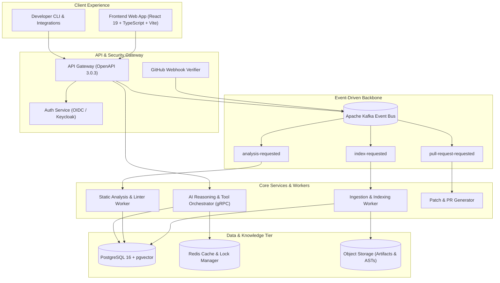

# DevSync AI

<div align="center">


[](https://react.dev/)
[](https://www.typescriptlang.org/)
[](https://vitejs.dev/)
[](https://tailwindcss.com/)
[](contracts/openapi.json)
[](contracts/events/)

<p align="center">
  <strong>Next-generation AI-assisted repository understanding, code analysis, and controlled change review platform.</strong>
</p>

[Explore Frontend](frontend/) • [API & Event Contracts](contracts/) • [Engineering Documentation](docs/) • [System Architecture](docs/02-system-architecture.md)

---
</div>

## 📌 Overview

**DevSync AI** is an enterprise-grade platform designed to give engineering teams deep, grounded repository intelligence. By uniting immutable code indexing, event-driven background processing, and citation-grounded LLM reasoning, DevSync AI enables developers to safely understand, analyze, and propose verified changes across large-scale codebases.

### Why DevSync AI?
- **Zero-Hallucination Answers:** Every AI suggestion is strictly grounded in immutable repository snapshots with verifiable line citations.
- **Controlled Change Review:** AI cannot directly mutate code without approval gates, automated tests, and strict boundary validation.
- **Enterprise Isolation:** Multi-tenant workspace separation, RBAC permission matrices, audit logs, and private code protection.

---

## ⚡ Core Capabilities

| Feature | Description |
| :--- | :--- |
| **🔍 Repository Understanding** | Ingests Git repositories, builds semantic AST & symbol graphs, and keeps embeddings synced with every commit. |
| **💬 Grounded AI Assistant** | Interactive engineering chat with exact file/line citations and live code inspection via Model Context Protocol (MCP). |
| **🛡️ Controlled Change Reviews** | Generates verified patches, coordinates test executions, runs linters, and drafts automated Pull Requests. |
| **📊 Executive & Dev Dashboards** | Real-time visibility into repository sync health, indexing progress, worker queues, and activity timelines. |
| **⚙️ Multi-Environment Workspaces** | Native support for multi-environment orchestration (local, staging, prod) with isolated secrets and RBAC policies. |

---

## 🏗️ Architecture

DevSync AI operates on an asynchronous, event-driven microservices architecture backed by strict schema contracts.



---

## 📂 Project Structure

```text
DEVSYNC-AI/
├── contracts/                  # Formal API, RPC, and Event schemas
│   ├── events/                 # Kafka JSON Schemas (index, analysis, PR, retry)
│   ├── examples/               # Valid event payload test fixtures
│   ├── proto/                  # Protobuf / gRPC service contracts (AiService)
│   ├── tools/                  # Model Context Protocol (MCP) tool schemas
│   └── openapi.json            # Complete OpenAPI 3.0.3 REST specification
├── docs/                       # 28-part exhaustive engineering documentation
│   ├── wireframes/             # SVG architectural and UI wireframe designs
│   ├── reference/              # Canonical SQL DDL, JSON reports, env templates
│   └── README.md               # Master documentation index
├── frontend/                   # Modern React + Vite web application
│   ├── src/
│   │   ├── components/         # Design system primitives & domain UI
│   │   ├── features/           # AppShell, Assistant, Dashboard, Environments, Landing
│   │   └── styles/             # Tailwind CSS tokens and layout rules
│   └── package.json            # Vite + React + Radix + Tailwind setup
├── scripts/                    # Automation & CI validation tooling
│   ├── requirements-docs.txt   # Pinned documentation validator dependencies
│   └── validate_documentation.py # Contract, protobuf, SQL, and link validator
├── .gitignore                  # Production-ready git ignore configuration
├── AGENTS.md                   # Repository engineering rules & AI directives
└── README.md                   # Project overview & developer guide
```

---

## 🚀 Getting Started

### 1. Prerequisites
- **Node.js**: `v22.12.0` or higher
- **npm**: `v10.0.0` or higher
- **Python**: `3.11+` (for running contract validators)
- **Git**

### 2. Running the Frontend Locally

```bash
# Navigate to the frontend directory
cd frontend

# Install exact dependencies
npm ci

# Launch local development server
npm run dev
```

Visit [http://localhost:5173](http://localhost:5173) in your browser.

#### Available Frontend Scripts:
- `npm run dev`: Starts the Vite development server with HMR.
- `npm run build`: Runs TypeScript type check and generates production bundle in `dist/`.
- `npm run lint`: Checks source code with Oxlint.

---

### 3. Validating Contracts & Documentation

DevSync AI enforces strict consistency between documents, OpenAPI specs, Protobuf files, Kafka event schemas, and SQL DDL.

To run the automated validation suite:

```bash
# Create and activate Python virtual environment
python -m venv .venv
# Windows:
.venv\Scripts\activate
# Linux/macOS:
source .venv/bin/activate

# Install validation dependencies
pip install -r scripts/requirements-docs.txt

# Run the full validation engine
python scripts/validate_documentation.py
```

The script verifies:
- ✅ OpenAPI 3.0.3 schema validity
- ✅ Kafka event JSON Schemas against positive and negative fixtures
- ✅ Protobuf syntax and gRPC service definitions
- ✅ PostgreSQL DDL syntax in `docs/reference/schema.sql`
- ✅ Markdown link integrity and anchor cross-references

---

## 📚 Documentation Index

The complete documentation suite contains 28 detailed technical specifications:

| Area | Key Guides |
| :--- | :--- |
| **Product & Architecture** | • [01 - Product Requirements](docs/01-product-requirements.md)<br>• [02 - System Architecture](docs/02-system-architecture.md)<br>• [19 - Workflows & State Machines](docs/19-detailed-workflows-and-state-machines.md) |
| **Data & Contracts** | • [03 - Database Design](docs/03-database-design.md)<br>• [04 - API & Event Contracts](docs/04-api-and-event-contracts.md)<br>• [24 - Database Reference & Migrations](docs/24-database-reference-and-migrations.md)<br>• [Reference Schema SQL](docs/reference/schema.sql) |
| **AI & Tooling** | • [20 - AI, Retrieval, Tools, and MCP](docs/20-ai-retrieval-tools-and-mcp.md)<br>• [22 - Test Cases & AI Evaluation Catalog](docs/22-test-cases-and-evaluation-catalog.md) |
| **Security & Threat Model** | • [07 - Security & Access Design](docs/07-security-and-access.md)<br>• [11 - Permission Matrix & Threat Model](docs/11-permissions-and-threat-model.md) |
| **Operations & Deployment** | • [08 - Deployment & Operations Plan](docs/08-deployment-and-operations.md)<br>• [14 - Operational Runbooks](docs/14-operations-runbooks.md)<br>• [27 - Configuration & Toolchain Setup](docs/27-configuration-and-toolchain.md) |
| **UI/UX & Design** | • [10 - UI/UX Specification](docs/10-ui-ux-specification.md)<br>• [26 - UI Design System & Wireframes](docs/26-ui-design-system-and-wireframes.md) |

---

## 🔒 Security & Privacy

- **No Unauthorized Commits:** AI-suggested changes require human-in-the-loop approval.
- **Zero Secrets In Git:** All environment secrets are managed via secret managers (HashiCorp Vault / AWS Secrets Manager).
- **Audit Trails:** All AI queries, tool executions, and file reads are recorded with immutable timestamps and user identities.

---

## 📄 License & Governance

This project is maintained under strict engineering governance. For questions, roadmap contributions, or backlog details, refer to [docs/23-engineering-governance-and-backlog.md](docs/23-engineering-governance-and-backlog.md).
