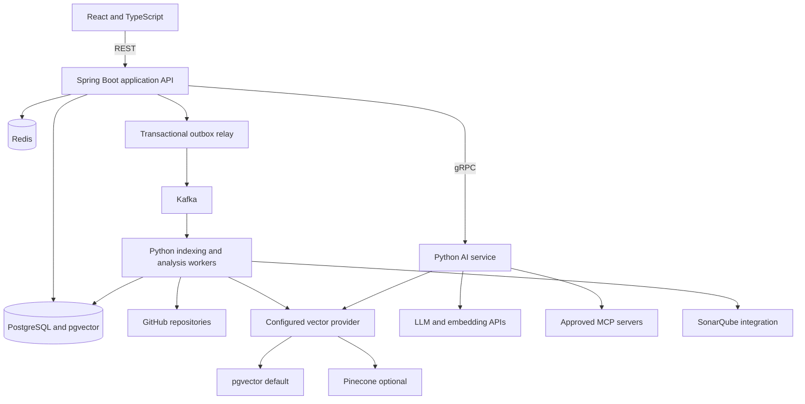

# System Architecture

## Proposed service layout

The vector-provider branches are alternatives per project/index, not a requirement to write to both. The AI service is a private service. FastAPI serves health and restricted administrative HTTP endpoints; a Python gRPC server handles typed application calls, with separate ports and a shared application layer.

## Stack responsibilities

| Technology | Responsibility |
|---|---|
| React + TypeScript | Dashboard, repository explorer, chat, analysis status, diff review, settings |
| Tailwind CSS + shadcn/ui | Responsive styles and reusable accessible UI components |
| Java + Spring Boot | Public API, project authorization, integrations, durable jobs, workflow and approval ownership |
| Python + FastAPI | AI orchestration and private health/admin endpoints |
| LLM API + RAG | Grounded answers using retrieved code and documentation |
| Tool Calling | Schema-validated model requests to policy-controlled operations |
| MCP | Standard adapters to approved tool servers; not a replacement for authorization |
| Tree-sitter | Structural code parsing, source locations, and function/class-aware chunks |
| SonarQube | Static analysis runs and normalized quality findings |
| PostgreSQL | Application records, authorization relationships, audit history, outbox |
| pgvector | Default embedding storage and project/revision-filtered similarity search |
| Pinecone | Optional vector adapter for a separately operated search service |
| Redis | Bounded caches, rate limits, and transient coordination; not authoritative job storage |
| Kafka | Durable asynchronous indexing/analysis commands and completion events |
| Spring Security + OAuth 2.0/OIDC | Login integration, token validation, and authorization enforcement |
| REST | Browser/public application API and inbound GitHub webhooks |
| gRPC | Private typed Java/Python requests, deadlines, cancellation, and answer streaming |
| JUnit + Mockito | Java tests and dependency isolation |
| React Testing Library | UI behavior and user interaction tests |
| Pytest | Python parsing, retrieval, orchestration, and tool tests |
| OpenTelemetry | Distributed instrumentation and trace propagation |
| Prometheus + Grafana | Operational metrics, dashboards, and alerts |
| Git + GitHub | Source history, integration access, branches, pull requests |
| GitHub Actions + Jenkins | PR validation and optional enterprise delivery pipelines using shared scripts |
| Docker + Kubernetes | Reproducible local containers and production orchestration |

## Indexing flow

Spring Boot writes the job and outbox row in one database transaction. A relay publishes the command to Kafka. The worker records a processing lease, fetches the selected commit into an isolated workspace, applies file/secret exclusions, parses and chunks code, generates embeddings, and writes a new index generation. Completion is persisted through the backend-owned job transition interface before the active-index pointer switches. Failed generations remain inactive and are cleaned up.

Kafka delivery is at least once. Job IDs and unique work-item keys make retries idempotent. The outbox avoids losing a command between database commit and publication; consumers still handle duplicates.

## Question-answering flow

The backend authenticates the user and creates a short-lived signed internal execution context. The AI service validates its audience, expiration, workspace, project, and allowed index generation. Retrieval always applies those filters. The LLM receives a bounded context and returns answer content plus references checked against retrieved chunks. Browser clients receive a REST response initially; a later streaming endpoint can bridge gRPC answer events.

## Tool and MCP boundary

The model proposes an operation. A tool gateway validates the schema, execution context, allowlist, resource scope, budget, and approval requirement before execution. Initial tools are read-only. Test execution runs in a separate sandbox. Repository content and MCP responses are untrusted input, not instructions capable of granting access.

## Code ownership and package layout

Proposed directories: `frontend/`, `backend/`, `ai-service/`, `contracts/proto/`, `infra/`, `scripts/`, and `docs/`. These directories are not yet scaffolded. Backend owns application tables; Python owns chunk/vector persistence through a restricted database role and contract. Avoid duplicating workflow business rules across services.

## Deployment progression

Start with a local end-to-end vertical slice. Add Kafka/outbox reliability before background workloads grow. Implement pgvector first and retain a vector-provider interface for Pinecone. Use GitHub Actions for initial checks; add Jenkins and Kubernetes after application behavior and deployment needs are established.
