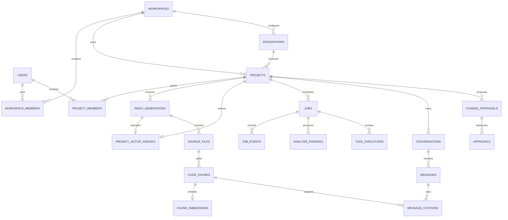

# ER Diagram and Data Lifecycle

The logical entities are defined in [Database Design](03-database-design.md). This diagram is the core relationship view; it does not replace migration constraints.

## Constraints to implement

- Unique identity `(oidc_issuer, oidc_subject)` and membership pairs.
- Composite scope consistency for project/generation/file/chunk relationships.
- `start_line >= 1`, `end_line >= start_line`; validate end line against source metadata in ingestion.
- Unique job idempotency key within requester, project, and operation scope; store request hash.
- Unique `(consumer_name, event_id)` and monotonic job-event sequence per attempt.
- Active index must be a validated generation of the same project.
- Index source paths normalize separators and reject paths escaping the repository root.

## Lifecycle

Ingestion creates an inactive generation. Validation checks commit identity, file/chunk counts, embedding compatibility, and retrieval smoke results. Activation uses a transaction and project-level concurrency control to avoid an older job overwriting a newer intended generation. Old generations remain only as long as retention/citation policy allows.

When a generation expires, choose and document whether historical citations resolve through GitHub or a retained source snapshot. Do not cascade-delete citation history accidentally. Project deletion creates a cleanup manifest for PostgreSQL rows, remote vector IDs, caches, and artifacts; cleanup retries are idempotent and auditable.

## Migration deliverables

The complete [reference DDL](reference/schema.sql), dimension, session/retention defaults and [migration specification](24-database-reference-and-migrations.md) are supplied. Turning the reference into applied, tested Flyway migrations is application implementation, not a missing design decision. Required migration order: identity/workspaces → integrations/projects/grants → jobs/outbox → generations/files/chunks → vector tables/indexes → chat/citations → findings/proposals/approvals → audit/cleanup tracking.

Each migration needs a forward plan, compatibility note, restore strategy, representative-data test, and lock-duration review. Avoid claiming that a reverse SQL migration can safely recover deleted production data.
