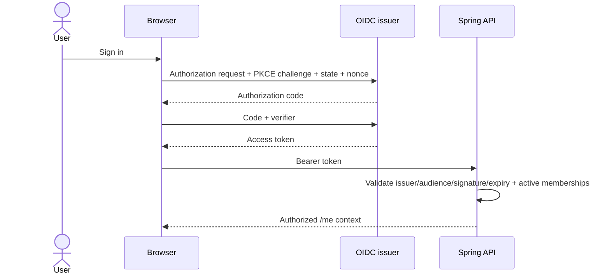
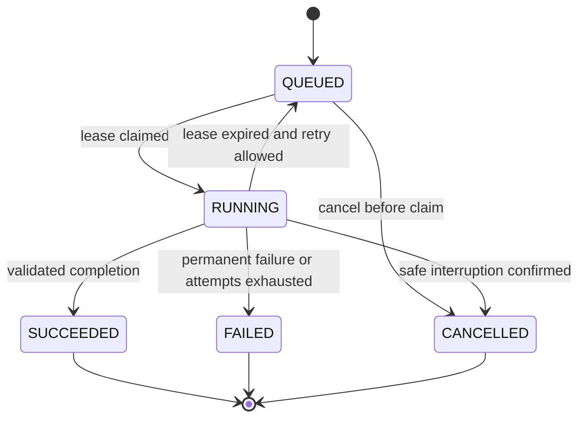

# Detailed Workflows and State Machines

## Authentication and membership



Check state/nonce and configured redirect URI. Never accept an identity token as an API access token. The initial SPA has no long-lived browser refresh-token storage. Logout clears memory and initiates provider logout where configured. Workspace membership revocation is checked on every request; sensitive operations do not rely solely on token role claims.

## Indexing and activation

```mermaid
sequenceDiagram
  participant B as Browser
  participant A as Backend
  participant D as PostgreSQL
  participant K as Kafka
  participant W as Worker
  B->>A: Index request + idempotency key
  A->>A: Check grant, repo access, quotas; resolve SHA
  A->>D: Transaction: job + inactive generation + outbox
  A-->>B: 202 + job status URL
  A->>K: Outbox relay publishes event
  K->>W: At-least-once delivery
  W->>A: Claim job lease and attempt capability
  W->>W: Fetch SHA; exclude; parse; embed; persist inactive generation
  W->>A: Validate/complete using current attempt token
  A->>D: Transaction: compare desired generation, activate, complete, outbox
  A-->>W: Accepted terminal state
```

Claim uses a compare-and-set transition; duplicate consumers do not both obtain a lease. A stale attempt token cannot report success. Older generations cannot overwrite the current desired generation. Kafka acknowledgment follows durable processing progress; consumers do not mark deduplication complete before job acceptance/terminal handling is committed.



Each RUNNING→QUEUED transition increments the attempt when claimed again, rotates the capability, and preserves events. A user retry creates a new job linked to the previous one with a new idempotency key; terminal jobs never silently change back to running. `cancellation_requested_at` is separate from terminal status.

## Q&A consistency

Backend captures the active generation at request start, persists the user message, allocates a request ID and budget reservation, and passes a signed scope to AI. All retrieval/tool reads stay on that generation. Reindex activation during a question does not change its scope. Backend validates references and persists the assistant message before returning success. A repeated message idempotency key returns the same completed result or an explicit in-progress conflict; it never double-bills intentionally.

Conversation messages are owner-private in the initial release. Maintainers cannot read another user's private conversation by project role alone. Conversation deletion removes message content and references subject to backup expiry; minimal billing/audit metadata is separate.

## Proposals and approvals

Proposal states: DRAFT → TESTING → READY_FOR_REVIEW → APPROVED → PR_CREATING → PR_CREATED. TESTING can become TEST_FAILED; a new patch revision returns to DRAFT. REJECTED/CANCELLED terminate the current proposal. Expired approval or base movement returns the proposal to READY_FOR_REVIEW and blocks writes.

Calculate patch hash from canonical UTF-8 unified diff bytes with LF line endings, repository ID and base SHA included in the signed approval context. Do not normalize semantic source contents silently. Re-check permission, exact patch, base and policy immediately before writing. Use a deterministic branch key derived from proposal ID; on GitHub timeout reconcile existing branch/PR before retry. Never force-push a user's unrelated branch or merge automatically.

## Deletion and revocation

Project deletion tombstones the project and increments its authorization epoch before queueing cleanup. Every active job/tool checks tombstone/epoch before sensitive reads/writes; cancellation is requested for active work. Cleanup is a privileged narrow service capability that can delete data for a tombstoned project but cannot expose it. Membership revocation blocks further chat/tool access and invalidates cached authorization.
