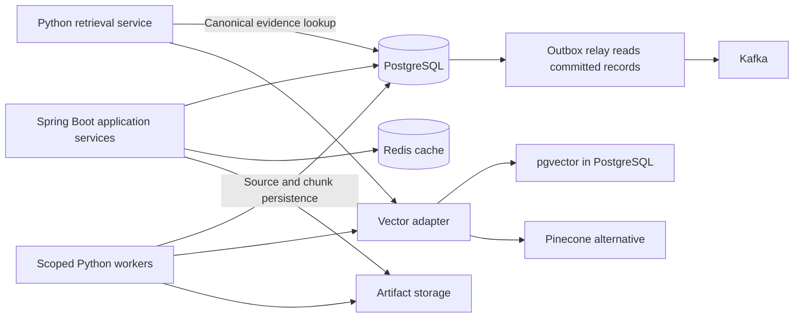
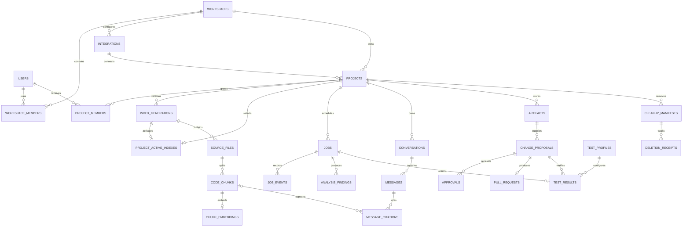

# DevSync AI — Database Design

Date: 25 October 2026. Status: standalone target database specification. This document defines storage organization, relationships, integrity, access patterns and lifecycle. It does not create a database or execute migrations.

## 1. Database architecture

PostgreSQL is the canonical store for identity mappings, project permissions, repository metadata, source snapshots, jobs, conversations, findings, approvals and usage reservations. pgvector provides the default embedding search inside PostgreSQL. Pinecone is an alternative vector provider chosen per generation. Redis is a bounded cache; Kafka transports commands/events. Neither replaces durable relational workflow state.

Artifact bytes such as patches and test output live in artifact storage; PostgreSQL retains their scope, checksum, size and expiry. The outbox connection represents a relay reading database records, not a database trigger publishing directly to Kafka.

## 2. Conventions and modeling rules

| Concern | Design |
|---|---|
| Physical reference | PostgreSQL with approved pgvector extension; existing DDL is a reference, not an applied migration |
| Identifiers | Application-generated UUIDs; external GitHub IDs stored as text |
| Naming | snake_case tables/columns; explicit DTO mapping to API camelCase |
| Time | UTC instants in timestamptz; UTC date for daily budget accounting |
| Money | Fixed-precision numeric values, never binary floating-point ledger totals |
| Source location | Normalized repository-relative path, immutable SHA, 1-based inclusive line range |
| Flexible metadata | Bounded JSONB for policy lists, sanitized metadata and cleanup progress |
| Authorization | Active workspace membership plus explicit project grant; owner-private conversations |
| Credentials | Secret-manager references or one-way capability hashes; no ordinary plaintext credential columns |
| Deletion | Immediate project tombstone/access revocation followed by tracked cleanup |

Normalize identity, permissions, projects and workflow relationships. Deliberately duplicate workspace/project/generation scope on indexing tables to support composite integrity and efficient filtering. Preserve citation snapshots so deleting old chunks does not erase the provenance of a historical answer.

## 3. Complete table inventory

All 34 tables in the existing reference schema are accounted for below. Detailed column types and SQL constraints are in the separate [Schema Design](SCHEMA-DESIGN.md) and [reference DDL](reference/schema.sql).

| Table | Primary key | Purpose and important relationships |
|---|---|---|
| users | id | OIDC identity mapping; unique issuer + subject |
| workspaces | id | Tenant, policy, private-source setting and daily token/cost ceilings |
| workspace_members | workspace_id + user_id | Active membership, workspace role, explicit permissions and revision |
| integrations | id | Workspace GitHub installation, credential reference and access status |
| projects | id | Repository connection, branch, authorization epoch, desired generation and tombstone |
| project_members | project_id + user_id | Explicit project role/permissions; membership bound to same workspace |
| index_generations | id | Immutable SHA, vector provider, embedding model/dimension, chunker and lifecycle |
| project_active_indexes | project_id | One active generation pointer per project, scoped by composite FK |
| source_files | id | Canonical eligible file snapshot, path/hash/language/line count and parse quality |
| code_chunks | id | Structural/text chunk, source range, symbol, content/hash and token count |
| chunk_embeddings | chunk_id | pgvector embedding tied to canonical scoped chunk |
| jobs | id | Job type/state, requester, generation, attempt, lease, cancellation and result reference |
| idempotency_records | id | Actor/workspace/operation key, request hash, durable result and expiry |
| job_events | id | Attempt-scoped monotonic progress sequence, stage and sanitized metadata |
| outbox_events | id | Transactionally committed commands/outcomes awaiting publication |
| consumed_events | consumer_name + event_id | Durable event deduplication |
| webhook_deliveries | delivery_id | Verified delivery identity/hash and integration association |
| conversations | id | Project-scoped, user-owned conversation |
| messages | id | USER/ASSISTANT content, generation reference, request/provider IDs and prompt metadata |
| message_citations | id | Answer reference with nullable chunk link plus SHA/path/line snapshot |
| analysis_findings | id | SonarQube rule, severity, location, commit and fingerprint for a job |
| artifacts | id | Project-scoped stored bytes reference, checksum, kind, size and expiry |
| change_proposals | id | Immutable patch artifact/hash, base SHA, creator, summary and review state |
| approvals | id | Proposal, reviewer, exact approved hash/base/action, decision and expiry/consumption |
| pull_requests | id | One PR intent/result per proposal, deterministic branch and external identity |
| test_profiles | id (text) | Global operator-reviewed fixed entrypoint/image/timeout; disabled until enabled |
| test_results | id | Unique test job result tied to proposal, profile and optional output artifact |
| mcp_servers | id | Workspace registry, endpoint/credential reference, schema fingerprint and allowed tools |
| tool_executions | id | Scoped invocation metadata, actor, argument hash, approval and outcome/timing |
| audit_events | id | Workspace security/change record with minimal sanitized details |
| spend_reservations | id | Workspace/day request reservation, actual usage, pricing configuration hash and reconciliation state |
| cleanup_manifests | id | Project cleanup job, initiator and retryable per-resource progress |
| deletion_receipts | id | Administrator-visible cleanup reference and expiry without source access |
| github_setup_sessions | id | Actor/workspace setup state hash, installation proof hash, expiry and consumption |

Generic resource IDs in jobs/idempotency/outbox are intentionally not polymorphic foreign keys. Application services validate their type, ownership and existence. Source ranges, approval bindings and financial limits also require application checks beyond SQL types.

## 4. Entity relationships

Support tables such as outbox, budgets and audit are listed in the inventory even where omitted from this readability-focused relationship view. The DDL defines actual composite keys and nullability.

## 5. Keys and integrity rules

| Rule | Database enforcement | Additional application enforcement |
|---|---|---|
| Stable user identity | Unique oidc_issuer + oidc_subject | Validate token before mapping subject |
| Membership uniqueness | Composite membership primary keys | Current active membership, permission delegation and last-owner protection |
| Repository connection | Partial unique live repository index per workspace/integration | Verify current installation access |
| Scope consistency | Composite project/generation/file/chunk foreign keys | Check actor authorization on each operation |
| One active index job | Partial unique project index for queued/running INDEX jobs | Worker lease and state transitions |
| Generation ownership | Composite active/desired pointer FKs | Only validated current intended generation activates |
| Valid source span | Positive start and end >= start checks | End within actual file; normalized confined path |
| Repeated request | Unique actor/workspace/scope/key | Canonical request hash; replay original result only |
| Event/progress duplicate | Unique consumer/event and job/attempt/sequence | Commit deduplication with durable acceptance |
| Approval | Proposal/actor/FK and decision/action checks | Exact repository/base/hash/action/expiry and current grant |
| Citation ownership | Message/chunk FK links | Chunk scope must match message's captured project/generation |
| Budget | Nonnegative numeric/token checks and unique request | Serialize workspace/day reservations and actual reconciliation |

Foreign keys prove record relationships, not user permission. Audit actors can be null for service/system events; user-facing records must distinguish those explicitly.

## 6. Index strategy and query patterns

The current DDL defines the following supporting indexes in addition to primary/unique-key indexes:

| Index | Query or invariant |
|---|---|
| projects_live_repository | Reject duplicate live project connection for one workspace/integration/repository |
| embeddings_scope | Filter embeddings by workspace/project/generation |
| one_active_index_job | Reject overlapping queued/running INDEX jobs per project |
| jobs_project_time | Read project job history by creation time and ID |
| outbox_unpublished | Efficiently claim oldest unpublished outbox batches |
| messages_conversation_time | Stable conversation history ordering |
| spend_workspace_day | Resolve current day reservations/reconciled spend |

Implementation index candidates, not already-created indexes: workspace project listing by `(workspace_id, created_at, id)` for live projects; user membership lookup by user; scoped conversation listing by project/owner/time; findings by project/severity; audit by workspace/time; expiry scans for idempotency/artifacts/setup/receipts. Add only through reviewed migrations and verify with representative query plans. PostgreSQL foreign keys do not automatically create every useful referencing-side index.

Use bounded keyset pagination with deterministic timestamp/ID ordering. Avoid unbounded history scans, N+1 source queries and fetching whole source files for short citations. Keep authorization predicates in the query/service path before returning results. Tune connection pools against total replica count and database capacity rather than giving every replica a large independent pool.

## 7. Vector database design

Default vector shape is `vector(1536)` in chunk_embeddings. Generation metadata identifies exact embedding model and chunker version. Query embeddings must use that configuration; reject mismatched dimensions, nonfinite values and mixed-model writes. Use cosine distance consistently across provider adapters.

Initial search is exact and filtered by workspace, project and generation. Resolve vector hits to canonical chunks and revalidate scope before assembling context. pgvector embeddings are database children; Pinecone records use stable canonical chunk IDs and corresponding generation/scope metadata. Do not write the same generation to both providers by default.

Enable approximate search only after measuring recall versus the exact filtered baseline. A model/dimension change requires a new generation and compatible physical index/table migration, not an in-place metadata edit. Partial or failed vector writes never become the active index. A provider outage returns controlled unavailability; no unfiltered fallback.

## 8. Transaction boundaries and concurrency

Index request: authorize and resolve SHA → begin transaction → lock project/check tombstone and epoch → check idempotency/conflicting job → create generation/job/desired pointer/outbox → commit. External GitHub/provider requests remain outside open transactions.

Worker claim: atomically check eligible job → increment attempt → store capability hash/lease expiry → record progress. Renewal validates attempt/capability. Completion locks job/project, validates actual generation and current desired pointer, swaps active state and records terminal job/outbox together. Stale attempts cannot overwrite a newer state.

Answer: persist scoped question/idempotency intent and spend reservation → call AI outside transaction → validate citation ownership → persist assistant content/reference snapshots and result → reconcile spend. Known-completed duplicate requests return the durable result; uncertain provider usage remains marked for review rather than assumed zero.

Approval/PR: record immutable proposal/test evidence → bind approval → create single-use write intent → perform external call → reconcile PR result. Timeout after external success must not create a duplicate PR. Project deletion: atomically tombstone/increment epoch, request cancellations and create cleanup job/manifest/receipt/outbox.

Use row locks/conditional updates for short critical sections; consistent lock ordering (workspace budget/project before dependent mutable rows where applicable) and bounded deadlock/serialization retries are implementation requirements. Never retry a non-idempotent external write blindly. The existing reference does not prescribe a blanket global SERIALIZABLE isolation level.

## 9. Redis, Kafka and artifact data

Redis cache keys include environment, workspace, project, generation and policy revision as needed. Job hints expire after five seconds, project summaries after 30 seconds and immutable source-range caches after five minutes. Recheck authorization on cache hits; membership revocation/tombstone invalidates access independently of TTL. Never rely on Redis alone for durable spend enforcement.

Kafka payloads contain identifiers and bounded metadata, not credentials/source snapshots. Outbox rows commit with application intent; consumers deduplicate only alongside durable acceptance. At-least-once transport still requires job leases, idempotent writes and external-effect reconciliation. Retain consumed-event deduplication for at least the longest supported broker replay window: baseline 14-day dead-letter retention, plus a documented recovery margin (initially one day); reject older replays for manual reconciliation.

Artifact records reference encrypted stored bytes by checksum/scope. Access goes through current backend permissions, with bounded/redacted test output. Retention cannot delete patch/test artifacts still needed for an unexpired review/write; invalidate the affected proposal/approval first or retain required bytes under the bounded operation lease.

## 10. Database security and service ownership

Backend identity owns product mutations through restricted application permissions. Python workers receive only the source/index capabilities needed for their assigned generation; do not share the unrestricted backend credential. Migration identity handles approved schema/extension changes. Readers cannot mutate approvals, budgets or audit history.

Use encrypted connections and storage; keep secrets out of SQL logs, JSONB, outbox payloads and telemetry. Parameterize queries and constrain identifiers/paths. Application-level scope checks are required; optional PostgreSQL row-level security is defense in depth and must be tested with pooling/service roles before use. Do not claim RLS exists in the current reference DDL.

Private source includes code snapshots, prompts/messages, embeddings, patches and output artifacts. Apply processor approval and deletion policy across PostgreSQL, vector providers, caches and artifact storage. Audit administrative/grant/write operations without copying private content unnecessarily.

## 11. Retention and cleanup design

| Data class | Baseline |
|---|---|
| Active index/source | Retain while project is active |
| Superseded index generation | Seven days |
| Chat, jobs, tool metadata and test/patch artifacts | 30 days, subject to bounded live-operation dependencies |
| Security audit metadata | 90 days |
| Idempotency records | 24 hours after operation lifecycle permits safe expiry |
| GitHub setup session / proof | 10 minutes / five minutes; consumed once |
| Approval | 15-minute validity; retain decision history under audit/product retention |
| Project deletion cleanup | Immediate read denial; cleanup target within 24 hours |
| Deletion receipt | 30 days |
| Encrypted backups | 30 days |

Generation deletion must respect references beyond files/chunks: clear active/desired pointers only when appropriate, detach nullable message and retained job generation references, remove embeddings/chunks/files in FK-safe order, and preserve citation snapshots. The current reference FK on messages/jobs does not automatically null generation links; lifecycle code must do so before deleting a generation. Citation chunk FK already specifies SET NULL; do not rely on a cascade that the DDL does not define.

Project cleanup follows a manifest with per-resource outcomes. Remove remote vectors/artifacts and source/message content, expire caches, then finish the manifest; retain only the authorized minimal tombstone, receipt and audit metadata. Source removal does not require destroying every project row immediately. Retry failed steps idempotently and alert when the 24-hour target is exceeded. Backup copies age out through expiry rather than promising immediate physical removal.

## 12. Capacity and maintenance

Baseline repository limits are 100 MiB eligible source, 10,000 files and one MiB/file. File content and chunk content are stored separately, so relational storage exceeds original source size. A 1536-component float32 vector has approximately 6,144 bytes of raw components before row/index overhead; 100,000 vectors therefore represent about 586 MiB of components alone. WAL, indexes, duplicate source/chunks, replicas, artifacts and backups add storage. These are sizing arithmetic, not a measured repository capacity claim.

Monitor database bytes, chunk/vector counts, query latency, connection saturation, locks, dead tuples, WAL/backup lag and cleanup age. Keep normal vacuum/analyze behavior enabled and tune from observed churn. Do not partition every table initially; introduce partitioning or larger source-storage changes only with measured need and an explicit migration plan.

## 13. Migration, backup and restore

Backend-owned Flyway sequence: identity/workspaces/integrations/projects/grants → jobs/outbox/idempotency → generations/source/vectors → conversations/citations → findings/artifacts/proposals/tests/approvals → MCP/tool/audit → budgets/cleanup and operational indexes. Schema dependency order governs actual file splitting; the reference SQL is not an executable migration bundle.

Use expand/backfill/switch/contract for deployed changes. Test both fresh install and previous-release upgrade, constraints, retained-data cleanup and representative query plans. Install pgvector with a separate privileged identity. Review index build lock/time behavior; destructive rollback is not a substitute for verified backups.

Recovery targets: RPO 15 minutes, RTO four hours for canonical data; vector rebuild target 24 hours. Use encrypted daily full backups plus continuous WAL coverage. Restore into isolated infrastructure with outbound writes blocked; validate memberships, source scope, active generation, retained artifacts and sample citations. Reconcile leases, outbox, consumed events, budgets and external PRs; invalidate pending approvals/internal contexts before resuming writes. Measure actual recovery against targets.

## 14. Database acceptance criteria

Fresh and upgrade migrations succeed on the selected PostgreSQL/pgvector build. Cross-workspace foreign links fail or are rejected by scoped application rules. Concurrent indexing, request replay, lease expiry, activation, spending reservations and approval consumption preserve invariants. Old-generation cleanup succeeds with retained jobs/messages/citations. Project deletion denies reads immediately and cleans all configured stores. Restore verifies real data consistency and external-side-effect reconciliation.

These are required implementation checks, not results claimed by this document. No existing files or database instances are modified by creating this separate design file.
