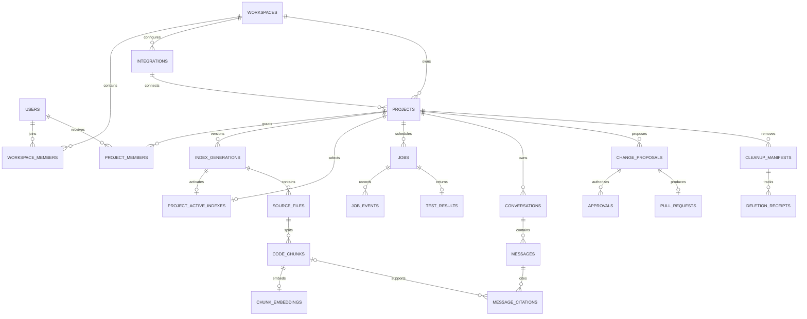

# DevSync AI — Schema Design

Date: 25 October 2026. Scope: standalone target data design. This file documents structure and invariants; it does not apply database migrations.

## 1. Storage boundaries

| Store | Data | Source of truth |
|---|---|---|
| PostgreSQL | Identity mappings, memberships, projects, source snapshots, chats, jobs, approvals, audit, budgets | Yes, for canonical product state |
| pgvector | 1536-dimensional code/document vectors linked to canonical chunk IDs | Rebuildable search projection; default provider |
| Pinecone | Alternative per-generation vector projection with scope metadata | Rebuildable search projection; not a second mandatory write |
| Redis | Scoped caches, rate counters, transient progress hints | No; durable jobs, permissions and spend remain in PostgreSQL |
| Kafka | Versioned commands and lifecycle events | Delivery log; database records determine workflow state |
| Artifact storage | Patch bytes, test logs, analysis reports and backups | Canonical artifact bytes identified by checksum and metadata |

Use one vector provider per index generation. An embedding-model or chunker change creates a new generation. PostgreSQL stores provenance even when Pinecone serves similarity search.

## 2. Naming, types and scope

- UUID primary keys generated by the application; external repository/installation IDs stored as text to avoid numeric-width assumptions.
- `timestamptz` for UTC instants; `date` for UTC budget days; integer counters; fixed-precision decimal money.
- Database names use snake_case; API names use camelCase through DTO mapping.
- Every project-owned record has an explicit scope or an unambiguous parent relationship. Composite keys bind `(workspace_id, project_id, generation_id)` across indexing tables.
- A workspace membership and an explicit project grant are both required for source access. Roles do not substitute for resource ownership checks.
- Store credential references and capability hashes, never reusable secrets in ordinary tables.
- JSONB is limited to bounded policy lists, sanitized metadata and processing manifests; core relationships remain relational.

## 3. Domain organization

| Domain | Tables |
|---|---|
| Identity and authorization | users, workspaces, workspace_members, project_members |
| Repository integrations | integrations, projects, github_setup_sessions, webhook_deliveries |
| Index and source | index_generations, project_active_indexes, source_files, code_chunks, chunk_embeddings |
| Durable execution | jobs, idempotency_records, job_events, outbox_events, consumed_events |
| Conversations | conversations, messages, message_citations |
| Analysis and changes | analysis_findings, artifacts, change_proposals, approvals, pull_requests, test_profiles, test_results |
| Tools, audit and budgets | mcp_servers, tool_executions, audit_events, spend_reservations |
| Deletion | cleanup_manifests, deletion_receipts |

## 4. Relationship diagram

The diagram shows primary relationships. The full table catalog below includes support entities and constraints.

## 5. Integrity and transactions

| Operation | Atomic records | Invariant |
|---|---|---|
| Create index job | job, generation, desired pointer, idempotency record, outbox | No lost accepted command; one active index job/project |
| Claim/renew worker | job lease, attempt/capability hash, progress event | Stale attempts cannot mutate current work |
| Activate index | validated generation, active/desired pointers, terminal job, outbox | Partial/older generation cannot become active |
| Answer question | scoped question/idempotency record and spend reservation; later answer/citations | Persist result before returning completion; no silent duplicate charge |
| Reserve model budget | workspace/day serialized ledger mutation | Reserved + reconciled usage does not bypass configured cap |
| Approve/write patch | exact proposal/base/hash binding, approval consumption, PR intent | Expired/changed approvals cannot authorize a different write |
| Delete project | tombstone, auth epoch increment, cleanup manifest/job/receipt, outbox | Reads denied immediately; cleanup remains retryable |

Network calls are outside database transactions. External results are reconciled with durable intent records; a timeout does not prove GitHub or a provider performed no side effect.

## 6. Query and index design

Membership lookup uses compound membership keys. Project list queries filter workspace and nondeleted state. Jobs and messages use `(parent_id, created_at, id)` pagination indexes. Outbox relay scans a partial index of unpublished events. A partial unique job index rejects concurrent queued/running index jobs for one project. Spending queries filter workspace/day/state.

Initial vector retrieval applies workspace/project/generation filters before cosine ordering. Validate all 1536 values are finite and the configured model matches generation metadata. Exact search is the correctness reference; an approximate index is enabled only after measuring filtered recall and latency. Do not create a global nearest-neighbor fallback that drops scope filters.

Redis keys include environment, workspace, project, generation and policy revision where applicable. Suggested TTLs: job-status hints 5 seconds, immutable source ranges 5 minutes, authorized project summaries 30 seconds. Recheck authorization even on cache hits. No provider tokens or private conversations in shared cache keys.

## 7. Retention and removal

Active index/source remains while project is active. Superseded generations expire after 7 days; chats, jobs, tool metadata and test/patch artifacts after 30 days; security audit metadata after 90 days. Project cleanup targets 24 hours after immediate access revocation. Encrypted backups expire after 30 days.

Before expiring a generation, detach nullable message generation links and citation chunk links while retaining immutable SHA/path/line snapshots. Remove embeddings, chunks and files in dependency-safe order. Historical references then require authorized GitHub access at that commit; missing historical source is displayed explicitly. Minimal tombstone/receipt rows can survive source cleanup without exposing content.

## 8. Migration and ownership

Backend owns Flyway migrations, application state, grants, leases, approvals and budgets. Python writes only assigned generation/source/vector data with a restricted identity. Migration order: identity/integrations → projects/grants → jobs/outbox → source/vectors → chat/citations → analysis/proposals/tests → MCP/audit → spend/cleanup.

Install extensions with an administrative migration identity; runtime roles do not administer schemas. Production changes use expand/backfill/switch/contract and fresh-install/upgrade verification. Backup restoration must reconcile outbox, leases, pending spend and external PRs before writes resume.

## 9. Complete table catalog

The following catalog reproduces the existing target DDL's columns, column constraints and table constraints so this design remains aligned with the project. Application-enforced invariants are distinguished from SQL constraints in section 5. Physical SQL reference: [schema.sql](reference/schema.sql).

### 9.1. users

| Column | SQL type and column rules |
|---|---|
| `id` | `uuid PRIMARY KEY` |
| `oidc_issuer` | `text NOT NULL` |
| `oidc_subject` | `text NOT NULL` |
| `display_name` | `text NOT NULL` |
| `created_at` | `timestamptz NOT NULL DEFAULT now()` |

Table-level constraints:

- `UNIQUE(oidc_issuer,oidc_subject)`

### 9.2. workspaces

| Column | SQL type and column rules |
|---|---|
| `id` | `uuid PRIMARY KEY` |
| `name` | `varchar(120) NOT NULL` |
| `revision` | `bigint NOT NULL DEFAULT 1` |
| `allow_private_source` | `boolean NOT NULL DEFAULT false` |
| `approved_processor_ids` | `jsonb NOT NULL DEFAULT '[]'` |
| `daily_token_limit` | `bigint NOT NULL DEFAULT 1000000 CHECK(daily_token_limit>0)` |
| `daily_cost_limit_usd` | `numeric(12,6) NOT NULL DEFAULT 5 CHECK(daily_cost_limit_usd>0)` |
| `created_at` | `timestamptz NOT NULL DEFAULT now()` |

### 9.3. workspace_members

| Column | SQL type and column rules |
|---|---|
| `workspace_id` | `uuid NOT NULL REFERENCES workspaces` |
| `user_id` | `uuid NOT NULL REFERENCES users` |
| `role` | `text NOT NULL CHECK(role IN ('OWNER','ADMIN','MEMBER'))` |
| `permissions` | `jsonb NOT NULL DEFAULT '[]'` |
| `active` | `boolean NOT NULL DEFAULT true` |
| `revision` | `bigint NOT NULL DEFAULT 1` |

Table-level constraints:

- `PRIMARY KEY(workspace_id,user_id)`

### 9.4. integrations

| Column | SQL type and column rules |
|---|---|
| `id` | `uuid PRIMARY KEY` |
| `workspace_id` | `uuid NOT NULL REFERENCES workspaces` |
| `provider` | `text NOT NULL CHECK(provider='GITHUB')` |
| `external_installation_id` | `text NOT NULL` |
| `credential_ref` | `text NOT NULL` |
| `status` | `text NOT NULL CHECK(status IN ('ACTIVE','REVOKED','ERROR'))` |
| `created_at` | `timestamptz NOT NULL DEFAULT now()` |

Table-level constraints:

- `UNIQUE(workspace_id,id)`
- `UNIQUE(workspace_id,provider,external_installation_id)`

### 9.5. projects

| Column | SQL type and column rules |
|---|---|
| `id` | `uuid PRIMARY KEY` |
| `workspace_id` | `uuid NOT NULL REFERENCES workspaces` |
| `integration_id` | `uuid NOT NULL` |
| `name` | `varchar(120) NOT NULL` |
| `repository_external_id` | `text NOT NULL` |
| `default_branch` | `text NOT NULL` |
| `auth_epoch` | `bigint NOT NULL DEFAULT 1` |
| `desired_generation_id` | `uuid` |
| `deleted_at` | `timestamptz` |
| `created_at` | `timestamptz NOT NULL DEFAULT now()` |
| `revision` | `bigint NOT NULL DEFAULT 1` |

Table-level constraints:

- `UNIQUE(workspace_id,id)`
- `FOREIGN KEY(workspace_id,integration_id) REFERENCES integrations(workspace_id,id)`

### 9.6. project_members

| Column | SQL type and column rules |
|---|---|
| `workspace_id` | `uuid NOT NULL` |
| `project_id` | `uuid NOT NULL` |
| `user_id` | `uuid NOT NULL` |
| `role` | `text NOT NULL CHECK(role IN ('MAINTAINER','READER'))` |
| `permissions` | `jsonb NOT NULL DEFAULT '[]'` |
| `revision` | `bigint NOT NULL DEFAULT 1` |

Table-level constraints:

- `PRIMARY KEY(project_id,user_id)`
- `FOREIGN KEY(workspace_id,project_id) REFERENCES projects(workspace_id,id)`
- `FOREIGN KEY(workspace_id,user_id) REFERENCES workspace_members(workspace_id,user_id)`

### 9.7. index_generations

| Column | SQL type and column rules |
|---|---|
| `id` | `uuid PRIMARY KEY` |
| `workspace_id` | `uuid NOT NULL` |
| `project_id` | `uuid NOT NULL` |
| `commit_sha` | `varchar(64) NOT NULL` |
| `provider` | `text NOT NULL CHECK(provider IN ('PGVECTOR','PINECONE'))` |
| `embedding_model` | `text NOT NULL` |
| `embedding_dimension` | `integer NOT NULL CHECK(embedding_dimension=1536)` |
| `chunker_version` | `text NOT NULL` |
| `status` | `text NOT NULL CHECK(status IN ('BUILDING','VALIDATED','ACTIVE','SUPERSEDED','FAILED','DELETING'))` |
| `created_at` | `timestamptz NOT NULL DEFAULT now()` |
| `validated_at` | `timestamptz` |

Table-level constraints:

- `UNIQUE(workspace_id,project_id,id)`
- `FOREIGN KEY(workspace_id,project_id) REFERENCES projects(workspace_id,id)`

### 9.8. project_active_indexes

| Column | SQL type and column rules |
|---|---|
| `workspace_id` | `uuid NOT NULL` |
| `project_id` | `uuid PRIMARY KEY` |
| `generation_id` | `uuid NOT NULL UNIQUE` |
| `activated_at` | `timestamptz NOT NULL DEFAULT now()` |

Table-level constraints:

- `FOREIGN KEY(workspace_id,project_id) REFERENCES projects(workspace_id,id)`
- `FOREIGN KEY(workspace_id,project_id,generation_id) REFERENCES index_generations(workspace_id,project_id,id)`

### 9.9. source_files

| Column | SQL type and column rules |
|---|---|
| `id` | `uuid PRIMARY KEY` |
| `workspace_id` | `uuid NOT NULL` |
| `project_id` | `uuid NOT NULL` |
| `generation_id` | `uuid NOT NULL` |
| `path` | `text NOT NULL` |
| `content_hash` | `char(64) NOT NULL` |
| `language` | `text NOT NULL` |
| `content` | `text NOT NULL` |
| `line_count` | `integer NOT NULL CHECK(line_count>=0)` |
| `parse_quality` | `text NOT NULL` |

Table-level constraints:

- `UNIQUE(workspace_id,project_id,generation_id,id)`
- `UNIQUE(generation_id,path)`
- `FOREIGN KEY(workspace_id,project_id,generation_id) REFERENCES index_generations(workspace_id,project_id,id)`

### 9.10. code_chunks

| Column | SQL type and column rules |
|---|---|
| `id` | `uuid PRIMARY KEY` |
| `workspace_id` | `uuid NOT NULL` |
| `project_id` | `uuid NOT NULL` |
| `generation_id` | `uuid NOT NULL` |
| `source_file_id` | `uuid NOT NULL` |
| `start_line` | `integer NOT NULL CHECK(start_line>=1)` |
| `end_line` | `integer NOT NULL CHECK(end_line>=start_line)` |
| `symbol` | `text` |
| `content` | `text NOT NULL` |
| `content_hash` | `char(64) NOT NULL` |
| `token_count` | `integer NOT NULL CHECK(token_count>=0)` |

Table-level constraints:

- `UNIQUE(workspace_id,project_id,generation_id,id)`
- `UNIQUE(generation_id,source_file_id,start_line,end_line,content_hash)`
- `FOREIGN KEY(workspace_id,project_id,generation_id,source_file_id) REFERENCES source_files(workspace_id,project_id,generation_id,id)`

### 9.11. chunk_embeddings

| Column | SQL type and column rules |
|---|---|
| `chunk_id` | `uuid PRIMARY KEY` |
| `workspace_id` | `uuid NOT NULL` |
| `project_id` | `uuid NOT NULL` |
| `generation_id` | `uuid NOT NULL` |
| `embedding` | `vector(1536) NOT NULL` |

Table-level constraints:

- `FOREIGN KEY(workspace_id,project_id,generation_id,chunk_id) REFERENCES code_chunks(workspace_id,project_id,generation_id,id) ON DELETE CASCADE`

### 9.12. jobs

| Column | SQL type and column rules |
|---|---|
| `id` | `uuid PRIMARY KEY` |
| `workspace_id` | `uuid NOT NULL` |
| `project_id` | `uuid NOT NULL` |
| `requested_by` | `uuid REFERENCES users` |
| `type` | `text NOT NULL CHECK(type IN ('INDEX','ANALYSIS','TEST','PR_CREATE','CLEANUP'))` |
| `status` | `text NOT NULL CHECK(status IN ('QUEUED','RUNNING','SUCCEEDED','FAILED','CANCELLED'))` |
| `retry_of` | `uuid REFERENCES jobs` |
| `generation_id` | `uuid` |
| `result_resource_id` | `uuid` |
| `attempt` | `integer NOT NULL DEFAULT 0 CHECK(attempt BETWEEN 0 AND 3)` |
| `attempt_token_hash` | `char(64)` |
| `lease_expires_at` | `timestamptz` |
| `cancellation_requested_at` | `timestamptz` |
| `error_code` | `varchar(80)` |
| `created_at` | `timestamptz NOT NULL DEFAULT now()` |
| `completed_at` | `timestamptz` |

Table-level constraints:

- `UNIQUE(workspace_id,project_id,id)`
- `FOREIGN KEY(workspace_id,project_id) REFERENCES projects(workspace_id,id)`
- `FOREIGN KEY(workspace_id,project_id,generation_id) REFERENCES index_generations(workspace_id,project_id,id)`

### 9.13. idempotency_records

| Column | SQL type and column rules |
|---|---|
| `id` | `uuid PRIMARY KEY` |
| `actor_id` | `uuid NOT NULL REFERENCES users` |
| `workspace_id` | `uuid NOT NULL REFERENCES workspaces` |
| `scope_key` | `text NOT NULL` |
| `key` | `varchar(200) NOT NULL` |
| `request_hash` | `char(64) NOT NULL` |
| `resource_id` | `uuid` |
| `response_ref` | `text` |
| `state` | `text NOT NULL CHECK(state IN ('IN_PROGRESS','COMPLETED','FAILED'))` |
| `expires_at` | `timestamptz NOT NULL` |

Table-level constraints:

- `UNIQUE(actor_id,workspace_id,scope_key,key)`

### 9.14. job_events

| Column | SQL type and column rules |
|---|---|
| `id` | `uuid PRIMARY KEY` |
| `job_id` | `uuid NOT NULL REFERENCES jobs` |
| `attempt` | `integer NOT NULL CHECK(attempt>=0)` |
| `sequence` | `bigint NOT NULL CHECK(sequence>=1)` |
| `event_type` | `text NOT NULL` |
| `stage` | `text NOT NULL` |
| `sanitized_payload` | `jsonb NOT NULL DEFAULT '{}'` |
| `created_at` | `timestamptz NOT NULL DEFAULT now()` |

Table-level constraints:

- `UNIQUE(job_id,attempt,sequence)`

### 9.15. outbox_events

| Column | SQL type and column rules |
|---|---|
| `id` | `uuid PRIMARY KEY` |
| `aggregate_id` | `uuid NOT NULL` |
| `event_type` | `text NOT NULL` |
| `payload` | `jsonb NOT NULL` |
| `created_at` | `timestamptz NOT NULL DEFAULT now()` |
| `published_at` | `timestamptz` |
| `publish_attempt` | `integer NOT NULL DEFAULT 0` |
| `lease_expires_at` | `timestamptz` |

### 9.16. consumed_events

| Column | SQL type and column rules |
|---|---|
| `consumer_name` | `text NOT NULL` |
| `event_id` | `uuid NOT NULL` |
| `processed_at` | `timestamptz NOT NULL DEFAULT now()` |

Table-level constraints:

- `PRIMARY KEY(consumer_name,event_id)`

### 9.17. webhook_deliveries

| Column | SQL type and column rules |
|---|---|
| `delivery_id` | `text PRIMARY KEY` |
| `integration_id` | `uuid REFERENCES integrations` |
| `event_type` | `text NOT NULL` |
| `received_at` | `timestamptz NOT NULL DEFAULT now()` |
| `payload_hash` | `char(64) NOT NULL` |

### 9.18. conversations

| Column | SQL type and column rules |
|---|---|
| `id` | `uuid PRIMARY KEY` |
| `workspace_id` | `uuid NOT NULL` |
| `project_id` | `uuid NOT NULL` |
| `owner_id` | `uuid NOT NULL REFERENCES users` |
| `title` | `varchar(200) NOT NULL` |
| `created_at` | `timestamptz NOT NULL DEFAULT now()` |

Table-level constraints:

- `UNIQUE(workspace_id,project_id,id)`
- `FOREIGN KEY(workspace_id,project_id) REFERENCES projects(workspace_id,id)`

### 9.19. messages

| Column | SQL type and column rules |
|---|---|
| `id` | `uuid PRIMARY KEY` |
| `workspace_id` | `uuid NOT NULL` |
| `project_id` | `uuid NOT NULL` |
| `conversation_id` | `uuid NOT NULL` |
| `role` | `text NOT NULL CHECK(role IN ('USER','ASSISTANT'))` |
| `content` | `text NOT NULL` |
| `generation_id` | `uuid` |
| `provider_request_id` | `text` |
| `request_id` | `uuid NOT NULL` |
| `insufficient_context` | `boolean NOT NULL DEFAULT false` |
| `prompt_version` | `text` |
| `model_config_hash` | `char(64)` |
| `created_at` | `timestamptz NOT NULL DEFAULT now()` |

Table-level constraints:

- `FOREIGN KEY(workspace_id,project_id,conversation_id) REFERENCES conversations(workspace_id,project_id,id) ON DELETE CASCADE`
- `FOREIGN KEY(workspace_id,project_id,generation_id) REFERENCES index_generations(workspace_id,project_id,id)`

### 9.20. message_citations

| Column | SQL type and column rules |
|---|---|
| `id` | `uuid PRIMARY KEY` |
| `message_id` | `uuid NOT NULL REFERENCES messages ON DELETE CASCADE` |
| `chunk_id` | `uuid REFERENCES code_chunks(id) ON DELETE SET NULL` |
| `commit_sha` | `varchar(64) NOT NULL` |
| `path` | `text NOT NULL` |
| `start_line` | `integer NOT NULL CHECK(start_line>=1)` |
| `end_line` | `integer NOT NULL CHECK(end_line>=start_line)` |

### 9.21. analysis_findings

| Column | SQL type and column rules |
|---|---|
| `id` | `uuid PRIMARY KEY` |
| `workspace_id` | `uuid NOT NULL` |
| `project_id` | `uuid NOT NULL` |
| `job_id` | `uuid NOT NULL` |
| `tool` | `text NOT NULL CHECK(tool='SONARQUBE')` |
| `rule_id` | `text NOT NULL` |
| `severity` | `text NOT NULL CHECK(severity IN ('INFO','LOW','MEDIUM','HIGH','CRITICAL'))` |
| `path` | `text NOT NULL` |
| `line` | `integer NOT NULL CHECK(line>=1)` |
| `commit_sha` | `varchar(64) NOT NULL` |
| `message` | `text NOT NULL` |
| `fingerprint` | `char(64) NOT NULL` |

Table-level constraints:

- `FOREIGN KEY(workspace_id,project_id,job_id) REFERENCES jobs(workspace_id,project_id,id)`
- `UNIQUE(job_id,fingerprint)`

### 9.22. artifacts

| Column | SQL type and column rules |
|---|---|
| `id` | `uuid PRIMARY KEY` |
| `workspace_id` | `uuid NOT NULL` |
| `project_id` | `uuid NOT NULL` |
| `kind` | `text NOT NULL CHECK(kind IN ('TEST_LOG','PATCH','REPORT'))` |
| `object_ref` | `text NOT NULL` |
| `content_hash` | `char(64) NOT NULL` |
| `byte_count` | `bigint NOT NULL CHECK(byte_count>=0)` |
| `content_type` | `text NOT NULL` |
| `expires_at` | `timestamptz NOT NULL` |

Table-level constraints:

- `UNIQUE(workspace_id,project_id,id)`
- `FOREIGN KEY(workspace_id,project_id) REFERENCES projects(workspace_id,id)`

### 9.23. change_proposals

| Column | SQL type and column rules |
|---|---|
| `id` | `uuid PRIMARY KEY` |
| `workspace_id` | `uuid NOT NULL` |
| `project_id` | `uuid NOT NULL` |
| `created_by` | `uuid NOT NULL REFERENCES users` |
| `base_commit_sha` | `varchar(64) NOT NULL` |
| `patch_artifact_id` | `uuid NOT NULL` |
| `patch_hash` | `char(64) NOT NULL` |
| `summary` | `text NOT NULL` |
| `status` | `text NOT NULL CHECK(status IN ('DRAFT','TESTING','TEST_FAILED','READY_FOR_REVIEW','APPROVED','PR_CREATING','PR_CREATED','REJECTED','CANCELLED'))` |
| `created_at` | `timestamptz NOT NULL DEFAULT now()` |

Table-level constraints:

- `UNIQUE(workspace_id,project_id,id)`
- `FOREIGN KEY(workspace_id,project_id) REFERENCES projects(workspace_id,id)`
- `FOREIGN KEY(workspace_id,project_id,patch_artifact_id) REFERENCES artifacts(workspace_id,project_id,id)`

### 9.24. approvals

| Column | SQL type and column rules |
|---|---|
| `id` | `uuid PRIMARY KEY` |
| `workspace_id` | `uuid NOT NULL` |
| `project_id` | `uuid NOT NULL` |
| `proposal_id` | `uuid NOT NULL` |
| `approver_id` | `uuid NOT NULL REFERENCES users` |
| `approved_patch_hash` | `char(64) NOT NULL` |
| `approved_base_sha` | `varchar(64) NOT NULL` |
| `action` | `text NOT NULL CHECK(action='CREATE_PULL_REQUEST')` |
| `decision` | `text NOT NULL CHECK(decision IN ('APPROVE','REJECT'))` |
| `expires_at` | `timestamptz NOT NULL` |
| `consumed_at` | `timestamptz` |
| `created_at` | `timestamptz NOT NULL DEFAULT now()` |

Table-level constraints:

- `UNIQUE(workspace_id,project_id,id)`
- `FOREIGN KEY(workspace_id,project_id,proposal_id) REFERENCES change_proposals(workspace_id,project_id,id)`

### 9.25. pull_requests

| Column | SQL type and column rules |
|---|---|
| `id` | `uuid PRIMARY KEY` |
| `workspace_id` | `uuid NOT NULL` |
| `project_id` | `uuid NOT NULL` |
| `proposal_id` | `uuid NOT NULL` |
| `approval_id` | `uuid NOT NULL` |
| `external_pr_id` | `text` |
| `url` | `text` |
| `branch_name` | `text NOT NULL` |
| `status` | `text NOT NULL CHECK(status IN ('CREATING','CREATED','FAILED'))` |

Table-level constraints:

- `UNIQUE(proposal_id)`
- `FOREIGN KEY(workspace_id,project_id,proposal_id) REFERENCES change_proposals(workspace_id,project_id,id)`
- `FOREIGN KEY(workspace_id,project_id,approval_id) REFERENCES approvals(workspace_id,project_id,id)`

### 9.26. test_profiles

| Column | SQL type and column rules |
|---|---|
| `id` | `text PRIMARY KEY` |
| `description` | `text NOT NULL` |
| `image_digest` | `text NOT NULL` |
| `entrypoint` | `jsonb NOT NULL` |
| `timeout_seconds` | `integer NOT NULL CHECK(timeout_seconds BETWEEN 1 AND 600)` |
| `enabled` | `boolean NOT NULL DEFAULT false` |

### 9.27. test_results

| Column | SQL type and column rules |
|---|---|
| `id` | `uuid PRIMARY KEY` |
| `workspace_id` | `uuid NOT NULL` |
| `project_id` | `uuid NOT NULL` |
| `job_id` | `uuid NOT NULL UNIQUE` |
| `proposal_id` | `uuid NOT NULL` |
| `test_profile_id` | `text NOT NULL REFERENCES test_profiles` |
| `outcome` | `text NOT NULL CHECK(outcome IN ('PENDING','PASS','FAIL','ERROR','TIMEOUT','CANCELLED'))` |
| `summary` | `text NOT NULL` |
| `artifact_id` | `uuid` |

Table-level constraints:

- `FOREIGN KEY(workspace_id,project_id,job_id) REFERENCES jobs(workspace_id,project_id,id)`
- `FOREIGN KEY(workspace_id,project_id,proposal_id) REFERENCES change_proposals(workspace_id,project_id,id)`
- `FOREIGN KEY(workspace_id,project_id,artifact_id) REFERENCES artifacts(workspace_id,project_id,id)`

### 9.28. mcp_servers

| Column | SQL type and column rules |
|---|---|
| `id` | `uuid PRIMARY KEY` |
| `workspace_id` | `uuid NOT NULL REFERENCES workspaces` |
| `name` | `varchar(120) NOT NULL` |
| `endpoint` | `text NOT NULL` |
| `credential_ref` | `text NOT NULL` |
| `allowed_tools` | `jsonb NOT NULL` |
| `schema_fingerprint` | `char(64) NOT NULL` |
| `status` | `text NOT NULL DEFAULT 'DISABLED' CHECK(status IN ('DISABLED','PENDING_REVIEW','ENABLED','ERROR'))` |
| `created_at` | `timestamptz NOT NULL DEFAULT now()` |

Table-level constraints:

- `UNIQUE(workspace_id,id)`

### 9.29. tool_executions

| Column | SQL type and column rules |
|---|---|
| `id` | `uuid PRIMARY KEY` |
| `workspace_id` | `uuid NOT NULL` |
| `project_id` | `uuid NOT NULL` |
| `job_id` | `uuid` |
| `actor_id` | `uuid NOT NULL REFERENCES users` |
| `tool_name` | `text NOT NULL` |
| `argument_hash` | `char(64) NOT NULL` |
| `approval_id` | `uuid` |
| `outcome` | `text NOT NULL` |
| `duration_ms` | `integer NOT NULL CHECK(duration_ms>=0)` |
| `created_at` | `timestamptz NOT NULL DEFAULT now()` |

Table-level constraints:

- `FOREIGN KEY(workspace_id,project_id) REFERENCES projects(workspace_id,id)`
- `FOREIGN KEY(workspace_id,project_id,job_id) REFERENCES jobs(workspace_id,project_id,id)`
- `FOREIGN KEY(workspace_id,project_id,approval_id) REFERENCES approvals(workspace_id,project_id,id)`

### 9.30. audit_events

| Column | SQL type and column rules |
|---|---|
| `id` | `uuid PRIMARY KEY` |
| `workspace_id` | `uuid NOT NULL REFERENCES workspaces` |
| `actor_id` | `uuid REFERENCES users` |
| `action` | `text NOT NULL` |
| `resource_type` | `text NOT NULL` |
| `resource_id` | `text NOT NULL` |
| `outcome` | `text NOT NULL` |
| `sanitized_details` | `jsonb NOT NULL DEFAULT '{}'` |
| `created_at` | `timestamptz NOT NULL DEFAULT now()` |

### 9.31. spend_reservations

| Column | SQL type and column rules |
|---|---|
| `id` | `uuid PRIMARY KEY` |
| `workspace_id` | `uuid NOT NULL REFERENCES workspaces` |
| `request_id` | `uuid NOT NULL UNIQUE` |
| `budget_date` | `date NOT NULL` |
| `model_config_hash` | `char(64) NOT NULL` |
| `reserved_tokens` | `bigint NOT NULL CHECK(reserved_tokens>=0)` |
| `actual_tokens` | `bigint CHECK(actual_tokens>=0)` |
| `reserved_usd` | `numeric(12,6) NOT NULL CHECK(reserved_usd>=0)` |
| `actual_usd` | `numeric(12,6) CHECK(actual_usd>=0)` |
| `state` | `text NOT NULL CHECK(state IN ('RESERVED','RECONCILED','CANCELLED','REVIEW_REQUIRED'))` |
| `created_at` | `timestamptz NOT NULL DEFAULT now()` |

### 9.32. cleanup_manifests

| Column | SQL type and column rules |
|---|---|
| `id` | `uuid PRIMARY KEY` |
| `workspace_id` | `uuid NOT NULL` |
| `project_id` | `uuid NOT NULL` |
| `job_id` | `uuid NOT NULL` |
| `initiated_by` | `uuid NOT NULL REFERENCES users` |
| `resource_progress` | `jsonb NOT NULL DEFAULT '{}'` |
| `created_at` | `timestamptz NOT NULL DEFAULT now()` |
| `completed_at` | `timestamptz` |

Table-level constraints:

- `UNIQUE(workspace_id,id)`
- `FOREIGN KEY(workspace_id,project_id) REFERENCES projects(workspace_id,id)`
- `FOREIGN KEY(workspace_id,project_id,job_id) REFERENCES jobs(workspace_id,project_id,id)`

### 9.33. deletion_receipts

| Column | SQL type and column rules |
|---|---|
| `id` | `uuid PRIMARY KEY` |
| `workspace_id` | `uuid NOT NULL REFERENCES workspaces` |
| `manifest_id` | `uuid NOT NULL` |
| `initiated_by` | `uuid NOT NULL REFERENCES users` |
| `expires_at` | `timestamptz NOT NULL` |

Table-level constraints:

- `FOREIGN KEY(workspace_id,manifest_id) REFERENCES cleanup_manifests(workspace_id,id)`

### 9.34. github_setup_sessions

| Column | SQL type and column rules |
|---|---|
| `id` | `uuid PRIMARY KEY` |
| `workspace_id` | `uuid NOT NULL REFERENCES workspaces` |
| `actor_id` | `uuid NOT NULL REFERENCES users` |
| `state_hash` | `char(64) NOT NULL UNIQUE` |
| `installation_id` | `text` |
| `proof_hash` | `char(64)` |
| `expires_at` | `timestamptz NOT NULL` |
| `consumed_at` | `timestamptz` |
| `created_at` | `timestamptz NOT NULL DEFAULT now()` |

## 10. Physical indexes and cross-reference constraint

- `CREATE UNIQUE INDEX projects_live_repository ON projects(workspace_id,integration_id,repository_external_id) WHERE deleted_at IS NULL;`
- `ALTER TABLE projects ADD CONSTRAINT desired_generation_scope_fk FOREIGN KEY(workspace_id,id,desired_generation_id) REFERENCES index_generations(workspace_id,project_id,id);`
- `CREATE INDEX embeddings_scope ON chunk_embeddings(workspace_id,project_id,generation_id);`
- `CREATE UNIQUE INDEX one_active_index_job ON jobs(project_id) WHERE type='INDEX' AND status IN ('QUEUED','RUNNING');`
- `CREATE INDEX jobs_project_time ON jobs(project_id,created_at DESC,id);`
- `CREATE INDEX outbox_unpublished ON outbox_events(created_at,id) WHERE published_at IS NULL;`
- `CREATE INDEX messages_conversation_time ON messages(conversation_id,created_at,id);`
- `CREATE INDEX spend_workspace_day ON spend_reservations(workspace_id,budget_date,state);`
