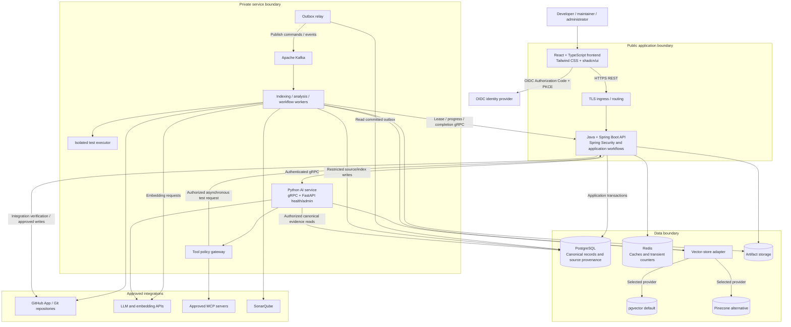
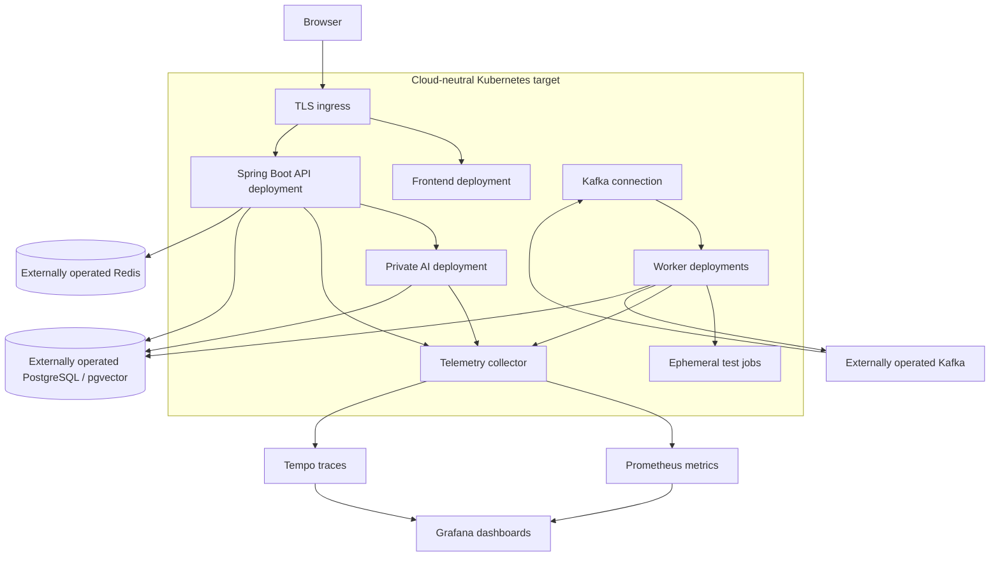

# DevSync AI — System Architecture

Date: 25 October 2026. Status: target architecture specification. This standalone document describes the system structure; application services and infrastructure are not implemented by this file.

## 1. Architecture approach

DevSync AI uses a modular Spring Boot application backend, a private Python AI service and asynchronous workers. The browser accesses the application through REST. Internal Java/Python operations use authenticated gRPC. Kafka carries durable background commands and lifecycle events. PostgreSQL owns canonical application state; vector search is a replaceable projection of indexed source.

Keep application workflows together in the backend initially. AI orchestration and repository processing are separate runtime boundaries because they use Python libraries and have different latency, scaling and execution requirements. Individual backend modules are not independent microservices unless later evidence justifies splitting them.

## 2. Complete component architecture

pgvector runs inside PostgreSQL; it is drawn separately to distinguish semantic-search responsibility. Pinecone is an alternative per index generation, not a second mandatory destination. Workers comprise separate handlers/processes where credentials differ; indexing workers do not automatically receive PR-writing or test-execution privileges. Browser traffic never directly reaches databases, Kafka, private AI endpoints or privileged tools.

## 3. Component responsibilities

| Component | Responsibilities | Boundary |
|---|---|---|
| Frontend | Workspace/project navigation, repository connection, chat, source citations, jobs, findings and review screens | Presentation and interaction; backend enforces authorization |
| Spring Boot API | Identity validation, memberships/grants, integrations, durable jobs, chat persistence, budgets, approvals and deletion | Owner of application rules and state transitions |
| Python AI service | Retrieval, prompt assembly, provider orchestration, output/citation validation and policy-mediated tool requests | Private computation service; no independent permission grants |
| FastAPI endpoints | Process health and restricted administration for the Python runtime | Private HTTP surface alongside gRPC, not a second public product API |
| Index worker | Fetch immutable commits, filter files, parse/chunk code, embed and build inactive generations | Scoped temporary workspace and restricted persistence role |
| Analysis worker | Run configured SonarQube workflow and normalize findings against source revision | Approved analysis identity and bounded workload |
| Workflow handlers | Dispatch approved tests/PR/cleanup operations and reconcile outcomes | Narrow per-operation capabilities |
| Tool gateway | Validate tool schemas, current scope, limits, permission, approval and normalized results | Common policy for native and MCP tools |
| Test executor | Run reviewed test profiles in ephemeral isolated environments | Separate from API/index workers; no host credentials |
| Outbox relay | Publish database-committed intent/events and record publication | Handles publication uncertainty and duplicate delivery |
| PostgreSQL | Product records, provenance, source chunks, jobs, audit, idempotency and spending | Canonical durable state |
| Redis | Scoped short-lived caches, rate hints and transient coordination | Rebuildable; not authoritative for grants, budget or jobs |
| Vector adapter | Filtered similarity search and generation lifecycle | Same scope/provenance contract for pgvector and Pinecone |
| Artifact storage | Patch bytes, sanitized test output and reports | Checksummed metadata in PostgreSQL; authorized access through backend |

## 4. Communication architecture

| Source → destination | Interface | Purpose |
|---|---|---|
| Browser → Spring Boot | HTTPS REST, `/api/v1` | Product operations and initial nonstreaming chat |
| Browser → OIDC issuer | Authorization Code + PKCE | User authentication |
| GitHub → backend webhook | Signed HTTPS webhook | Repository and installation events |
| Spring Boot → AI | Private gRPC | AnswerQuestion and ValidateIndex |
| Worker → Spring Boot | Private gRPC | ClaimJob, RenewJobLease, ReportJobProgress and CompleteIndex |
| Outbox relay → Kafka | Authenticated broker protocol | Durable command/event publication |
| Kafka → workers | Consumer groups with broker ACLs | Background dispatch and retries |
| Services → PostgreSQL | Scoped SQL connections | Canonical state/source persistence |
| AI/worker → model providers | Approved provider adapter | Chat generation and embeddings |
| Gateway → MCP servers | Configured authenticated MCP transport | Approved standardized tool invocation |
| Services → telemetry collector | OpenTelemetry export | Correlated operational telemetry |

Set explicit RPC/provider deadlines, payload limits and cancellation propagation. Service authentication and signed execution scope are both required internally. UUIDs or network location alone do not grant authority. Current gRPC contracts are unary; streaming requires an explicit future contract and is not implied by this design.

## 5. Repository indexing path

1. Backend validates project grant, integration access, repository limits and idempotency; resolves branch to a fixed commit SHA.
2. One transaction creates job, inactive generation, desired-generation pointer and outbox command.
3. Relay publishes the command; Kafka delivers at least once.
4. Worker claims a bounded lease through the backend; duplicates/stale attempts cannot obtain conflicting authority.
5. Worker fetches the exact commit, excludes unsafe/unsupported content and uses Tree-sitter to create structured chunks with source lines.
6. Embedding adapter validates model identity, dimension and finite values; selected vector adapter stores the inactive generation.
7. Completion validates source/counts/configuration and atomically activates only the current intended valid generation.
8. Failed/cancelled generation stays inactive; prior active index remains available.

Initial limits: 100 MiB eligible source, 10,000 files, 1 MiB/file, one active index job/project, two/workspace. Lease is 60 seconds with renewal every 20 seconds; processing allows at most three attempts.

## 6. Grounded answer path

Backend verifies current access and conversation ownership, captures active generation, persists question/idempotency intent and reserves model budget. AI validates signed scope, retrieves up to 20 filtered candidates, verifies canonical ownership and selects up to eight bounded chunks. LLM receives separated policy, question, history and untrusted evidence.

Tool requests pass through the policy gateway; the model cannot overwrite project, generation, credentials or permissions. Validate structured output and citation ranges against the captured source. Backend persists answer/reference snapshots and reconciles usage before returning a completed response. Unsupported questions receive an explicit insufficient-context result. Provider failure or invalid output is an error, not a fabricated successful answer.

RAG includes retrieval and evidence assembly. Tool calling is the model's structured invocation mechanism. MCP is an integration protocol behind the gateway; none replaces backend authorization.

## 7. Analysis, tests and change path

Analysis commands run SonarQube at the pinned revision and persist normalized rule/severity/source findings. Immutable patch proposals reference exact base SHA and checksum-addressed diff bytes. Approved test profiles run through isolated executors, producing explicit PASS/FAIL/ERROR/TIMEOUT/CANCELLED outcomes.

A permitted reviewer approves the exact repository, base, patch hash and write action for 15 minutes. A permitted PR writer requests the action; backend rechecks permission, tests, policy, base and approval immediately before writing. The PR handler uses deterministic branch/proposal identity and reconciles uncertain external outcomes before retry. A PR is not automatically merged or deployed.

## 8. State ownership and consistency

| State | Owner | Consistency rule |
|---|---|---|
| Membership and grants | Backend/PostgreSQL | Recheck current state; no implicit project access |
| Job lease/status | Backend/PostgreSQL | Compare-and-set transitions; stale token rejection |
| Source/index data | Scoped worker + backend activation | Immutable generation; validate before visibility |
| Vector entries | Selected provider adapter | Rebuildable projection tied to canonical chunk IDs |
| Conversation | Backend/PostgreSQL | Owner-private; source generation pinned per answer |
| Spending | Backend/PostgreSQL | Atomic reservations include in-flight calls |
| Approval and PR intent | Backend/PostgreSQL | Exact binding; no reuse for unrelated operations |
| Cache | Redis | Bounded TTL/scope; cannot override durable policy |
| Event transport | Kafka + outbox/deduplication | At-least-once; idempotent acceptance/processing |

Do not hold database transactions while waiting on external providers. Durable intent bridges network uncertainty. No exactly-once end-to-end delivery guarantee is claimed. Model changes require new generations, not relabeling existing vectors.

## 9. Security and execution boundaries

OIDC access tokens stay in browser memory in the baseline; Spring Security validates issuer, audience, signature and expiry. Source access requires active workspace membership plus explicit project grant. Workspace administration alone does not grant source or another user's conversation access.

Private source sharing is off until configured processors are approved. Keep credentials in secret storage and expose only narrowly scoped references internally. Repository content, model output and MCP responses are untrusted. Validate schemas, paths, ranges, endpoint allowlists and output sizes; enforce tool deadlines and approval policy server-side.

Test executor defaults: nonprivileged ephemeral runtime, read-only base source, dedicated scratch, network denied, no Docker socket/host secrets, 2 vCPU, 2 GiB RAM and 10-minute timeout. Separate identities enforce distinct permissions for indexing, analysis, PR writes and cleanup.

Project deletion commits tombstone and authorization-epoch increment before asynchronous cleanup. Ordinary reads stop immediately; narrow cleanup capability removes source/vectors/artifacts idempotently. Cleanup receipt does not expose source content.

## 10. Deployment architecture

Diagram connections identify runtime dependencies, not a complete firewall policy. Prometheus scrapes an appropriately configured metrics export/collector endpoint; Tempo receives trace export. Structured logs use the environment's configured log pipeline, with no private source or raw prompt bodies.

Local development uses Docker packaging and a dependency environment. Production separates frontend, API, AI, workers and test jobs; PostgreSQL/Kafka/Redis require explicit external operation, backups and recovery ownership. Network policy permits only required service-to-service and approved provider flows.

## 11. Delivery and verification architecture

Git/GitHub holds versioned source and contracts. GitHub Actions runs frontend build/type checks and React Testing Library tests, Java JUnit/Mockito and integration tests, Python Pytest, contract validation and image checks. SonarQube adds static-analysis findings/gates. Shared scripts reduce drift across pipeline systems.

Actions publishes immutable image digests and evidence. Jenkins promotes selected digests through staging and production under environment-specific authorization and deployment locks. Database migrations run as controlled jobs; rollback depends on schema compatibility. Docker supplies reproducible packaging; Kubernetes supplies workload placement, rolling updates, health checks and scaling.

## 12. Observability, scaling and recovery

OpenTelemetry propagates request/trace/job context through HTTP, gRPC and Kafka. Prometheus records bounded metrics; Grafana shows latency/errors, queue age, index success, lease expiry, provider usage/spend, cleanup age and backup coverage. Tempo is the trace backend. Avoid source paths, questions and user/project identifiers as metric labels.

Scale API/AI by measured concurrency/latency, workers by queue age plus provider capacity. Enforce per-project/workspace limits and durable spending caps before increasing replicas. Use backpressure, finite retries and dead-letter handling rather than unlimited work intake.

Targets requiring implementation evidence: metadata p95 below 500ms; reference Q&A p95 below 10s; 99.5% monthly metadata/Q&A availability measured separately; canonical-data RPO 15 minutes and RTO four hours. On restore, reconcile leases, outbox, budget reservations, approvals and external PR effects before resuming writes. Vectors can be rebuilt from retained authorized source/provenance.

## 13. Related standalone designs

- [Schema Design](SCHEMA-DESIGN.md): complete data dictionary, relationships and invariants.
- [Workflow](WORKFLOW.md): user journeys and service/state transitions.
- [UI Theme and Style Guide](UI-THEME-AND-STYLE-GUIDE.md): colors, typography, layout and interaction rules.
- [HLD](SYSTEM-DESIGN-HLD.md): high-level design context and quality boundaries.
- [LLD](SYSTEM-DESIGN-LLD.md): modules, contracts, algorithms and transaction details.

This file is a separate architecture specification; it does not merge or replace those documents.
