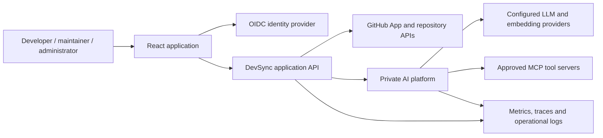
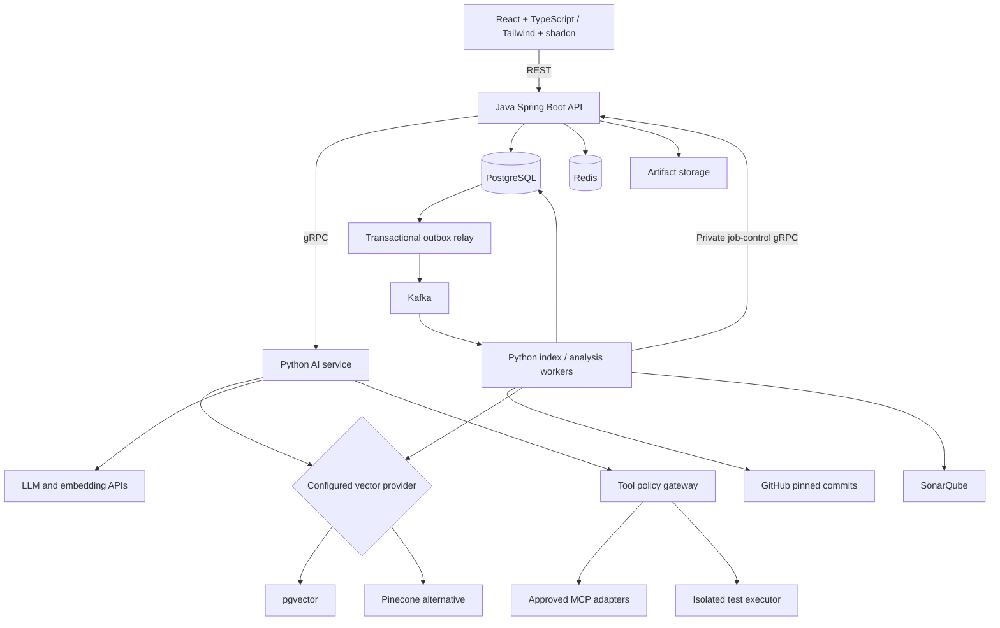

# DevSync AI — High-Level System Design (HLD)

Date: 25 October 2026. Scope: system boundaries, major components, communication, storage, deployment and quality attributes. Design target; no deployed services are claimed.

## 1. Product capabilities and actors

Developers connect authorized GitHub repositories, index immutable revisions and ask questions with source citations. Maintainers request analysis and propose changes. Explicitly permitted reviewers/writers approve exact patches and create PRs. Workspace administrators manage identities, integrations, processor policy and spending. The system never treats administrator status alone as source access.

MVP: login, memberships, repository connection, indexing, cited Q&A and lifecycle controls. Target extensions: tool calling/MCP, SonarQube, isolated tests, approved PRs, Pinecone adapter and production delivery.

## 2. System context

Only frontend/API ingress is public. Source code, embeddings and prompts containing code are restricted data; external processors require workspace policy approval. Identity provider authentication and GitHub repository authorization are separate concerns.

## 3. Container/service architecture

The outbox relay reads unpublished records; arrows do not imply database-trigger execution. Artifact bytes live outside the metadata database. Test executor has a separate trust/runtime boundary from API and indexing workers.

## 4. Responsibilities and stack

| Area | Technology | Responsibility |
|---|---|---|
| Product UI | React, TypeScript | Dashboard, repository/source view, chat, jobs, findings and review |
| UI system | Tailwind CSS, shadcn/ui | Semantic theme, reusable accessible controls and responsive layouts |
| Application API | Java, Spring Boot | Identity integration, grants, workflows, durable state, budget, approvals |
| AI platform | Python, FastAPI + gRPC | Retrieval/model orchestration; private health/admin HTTP and typed internal RPC |
| GenAI | LLM API, RAG, tool calling, MCP | Evidence-grounded answers and policy-controlled integrations |
| Code analysis | Tree-sitter, SonarQube | Structural chunks and normalized static findings |
| Relational store | PostgreSQL | Canonical application/source/provenance records |
| Vector retrieval | pgvector, optional Pinecone | Per-generation semantic search through one adapter interface |
| Caching | Redis | Short-lived scoped caches and transient rate counters |
| Events | Apache Kafka | Asynchronous indexing, analysis, test, PR and cleanup delivery |
| Security | Spring Security, OAuth 2.0/OIDC | Token validation, identity and resource/action authorization |
| Communication | REST, gRPC | Public browser APIs and private service contracts |
| Verification | JUnit, Mockito, RTL, Pytest | Java, frontend and Python correctness tests |
| Observability | OpenTelemetry, Prometheus, Grafana | Distributed telemetry, metrics, dashboards and alerts |
| Collaboration | Git, GitHub | Version history, installations, branches and PRs |
| Delivery | GitHub Actions, Jenkins | PR/image validation and controlled environment promotion |
| Packaging/runtime | Docker, Kubernetes | Reproducible service images and target production orchestration |

## 5. Major data paths

Indexing: API validates access and captures SHA → commits job/generation/outbox → Kafka delivers → worker claims lease → fetches/filters/parses/embeds → validates generation → backend atomically activates it.

Q&A: API captures authorized active generation and reserves budget → private AI RPC retrieves scoped chunks → model/tool loop runs within policy → backend validates references, persists answer and reconciles spend → UI opens cited source.

Approved change: immutable proposal → isolated tests and findings → exact approval → authorization/base/hash recheck → deterministic GitHub branch/PR → durable reconciliation and audit. Deployment and merge are separate from creating a PR.

## 6. Consistency and failure strategy

PostgreSQL transactions protect accepted work, activation, approval and budgets. Outbox publication and at-least-once Kafka delivery require consumer idempotency; no exactly-once end-to-end claim. Use short worker leases and bounded attempts. Network calls do not hold database locks. Reconcile uncertain external effects before repeating them.

New indexes remain inactive until validated; failed reindex leaves prior active index available. AI requests pin a generation for their lifetime. Redis loss degrades speed/rate hints, not durable state; critical authorization and cost controls fail closed against their authoritative state. A vector-provider outage returns explicit search unavailability rather than unscoped or fabricated answers.

## 7. Trust and scaling boundaries

Authenticate private RPCs with service identity and validate signed scope/audience/expiry. Recheck resource grants and tombstone/authorization epoch before sensitive actions. Broker ACLs and database roles enforce least privilege. Model/MCP/repository contents cannot grant authority. Execution sandboxes have no host secrets or unrestricted egress.

API and AI replicas scale independently. Workers scale with queue age/lag and bounded provider concurrency; one active index/project and two/workspace initially. Budget reservations are durable and serialized. Keep cache labels and telemetry dimensions bounded. Pinecone is an interchangeable provider, not a condition for initial scale.

## 8. Deployment and delivery

Local Docker environment groups application services and dependencies; optional analysis/observability profiles limit resource use. Target production uses separate frontend/API/AI/worker workloads in cloud-neutral Kubernetes, externally operated PostgreSQL/Kafka/Redis and encrypted artifacts. Internal services remain private. Runtime identities, DNS, secrets and exact image digests are deployment inputs.

GitHub Actions validates builds/tests/contracts and publishes immutable images. Jenkins promotes reviewed digests through staging and production using shared scripts and one environment deployment lock. Database migration is a controlled job; rolling back images requires schema compatibility.

## 9. Quality targets

Initial targets, requiring measured evidence: monthly metadata/Q&A availability 99.5% independently; metadata p95 <500ms; reference Q&A p95 <10s; eligible 100 MiB repository index <30min. Canonical-data recovery RPO 15min/RTO 4h; vector rebuild target 24h. Collect traces through OpenTelemetry with a trace backend, metrics through Prometheus and dashboards/alerts through Grafana; metrics are not trace storage.

Private source is excluded from routine logs and metric labels. Track latency/errors, queue age, indexing outcomes, cost reservations, cleanup age and backup coverage. Recovery must verify authorization, active generation, leases/outbox and external PR reconciliation before normal writes resume.

## 10. Design boundaries

This HLD covers all requested stack roles. Module/class interfaces and transactions are specified in the separate LLD; the schema, workflow and visual system are separate new files. Documentation does not imply purchased providers, working service code or a deployed cluster.
