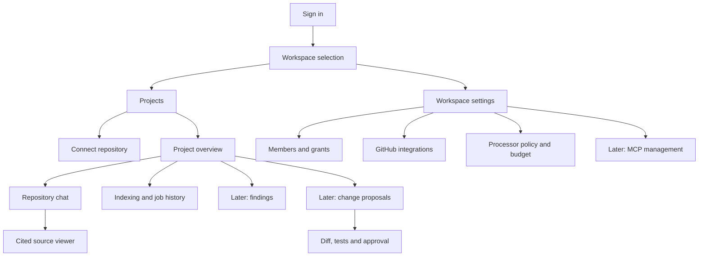

# DevSync AI — UI/UX Design

Date: 25 October 2026. Status: standalone product-interface design specification. This file defines intended screens, navigation, visual treatment and interactions; it does not implement a frontend or claim completed usability testing.

## 1. Experience goals

Help a developer connect an authorized repository, understand indexing readiness, ask a question and verify the answer against exact source. Later analysis/change screens should make findings, proposed diffs, test outcomes and approval scope easy to inspect before acting.

Prioritize readable code and explanations, visible workspace/project/revision context, predictable navigation and recoverable failures. Keep repository evidence, AI suggestions and approved changes visually distinguishable. Never show a capability as working before its implementation is available.

## 2. Users and permitted experiences

| User context | Primary needs | UI behavior |
|---|---|---|
| Project reader | Ask questions, inspect source and permitted findings | Show reading/chat actions; explain unavailable maintainer actions |
| Project maintainer | Index repository, inspect jobs, request analysis and propose patches | Show permitted job/analysis actions and their actual status |
| Explicit reviewer/writer | Inspect tests/diff, approve exact action, create PR | Require action-specific permission and current approval; role alone is insufficient |
| Workspace administrator | Manage memberships, integrations, processor policy and budget | Show management screens; no implicit source or private-chat access |

Client-side visibility improves usability; backend authorization remains authoritative. Do not expose private resource names in an unauthorized empty/error state.

## 3. Information architecture



Global shell: product identity, workspace/project switcher, breadcrumb and user/theme menu. Project navigation: Overview, Chat and Jobs; Findings/Changes appear only when enabled. Workspace Settings is separate from project navigation and restricted to permitted management functions.

## 4. Screen and route inventory

These are browser routes, not REST endpoints. Proposed UI routes must map to existing authorized API contracts; route names do not imply additional backend endpoints.

| Screen | Browser route | Primary action |
|---|---|---|
| Sign in | /login | Sign in with configured provider |
| Login callback | /auth/callback | Validate callback and return to safe intended route |
| Workspace selection | /workspaces | Open/create authorized workspace |
| Project list | /w/:workspaceId/projects | Open project or connect repository |
| Repository connection | /w/:workspaceId/projects/connect | Select repository/branch and connect |
| GitHub setup callback | /integrations/github/callback | Complete original scoped setup session |
| Project overview | /p/:projectId/overview | Open chat or start permitted indexing |
| Conversation | /p/:projectId/chat/:conversationId | Ask question and inspect references |
| Jobs | /p/:projectId/jobs | Inspect paginated history |
| Job details | /p/:projectId/jobs/:jobId | Inspect stage, cancel or retry if permitted |
| Findings | /p/:projectId/findings | Later: filter and open source evidence |
| Proposal list | /p/:projectId/proposals | Later: inspect proposed changes |
| Proposal review | /p/:projectId/proposals/:proposalId | Later: review exact diff/tests/approval |
| Workspace settings | /w/:workspaceId/settings | Manage permitted settings and integrations |
| Deletion receipt | /w/:workspaceId/deletion-receipts/:receiptId | Inspect cleanup progress without restoring source access |

Direct navigation/deep links must revalidate identity, membership and resource scope. Invalid or unauthorized private-resource links use a generic unavailable/not-found state with safe navigation back.

## 5. Primary user journeys

### 5.1. First repository connection

Sign in → select/create workspace → connect authorized GitHub installation if missing → choose accessible repository → choose branch → review private-source/provider policy and exclusions → connect → open indexing status → enter chat after a valid generation activates.

Connection wizard has four visible steps: Integration, Repository, Branch, Review. Keep selections when moving backward, clear dependent selections when integration/repository changes, and validate on each forward action. Summarize repository visibility and the processing policy before submit. Missing integration permission routes the user to an actionable administrator message, not an endless loading state.

### 5.2. Ask and verify

Open indexed project → create/select own conversation → enter question → submit once → show pending answer state → render answer or insufficient context → click numbered reference → inspect exact path/SHA/lines → return focus to original reference when closing source.

Do not clear unsent text on recoverable error. Capture revision visibly for each answer. A replacement index running in the background does not switch existing answers or their source references to a new revision.

### 5.3. Reindex and recover

Inspect current branch/indexed SHA → request reindex → display accepted job → show actual stages/attempts → preserve prior active index → activate new generation only after backend success. On failure display sanitized cause, prior index availability and permitted retry. Cancellation displays intent until terminal confirmation.

### 5.4. Review a proposed change

Later: open proposal → inspect changed files and immutable base/hash → inspect analysis/tests → approve/reject exact action when permitted → request PR creation with valid write grant → display durable outcome/status. Hash/base changes or approval expiration immediately invalidate the visible approved state. PR creation does not imply merge or deployment.

## 6. Screen-level design

### 6.1. Sign in and workspace selection

Sign-in page shows product name, a short purpose statement and one provider sign-in button. Identity provider handles credentials; do not invent a local password form. Error contains safe recovery text without callback codes/tokens. Workspace selection lists authorized memberships only, with search/pagination when needed. A new user can create a workspace where service policy permits; otherwise explain how to obtain access.

### 6.2. Project list

Header contains workspace name and permitted Connect repository action. Cards show repository name, visibility marker, selected branch, indexed SHA, readiness and latest successful index time. Search/filter controls reflect what the actual API supports; do not imply server search across all pages when only the loaded page is filtered. Use explicit next-page/load-more controls with a preserved list state.

Empty list explains the next permitted step. Existing projects with no active index show Not indexed; failed latest reindex does not erase a valid earlier index's Ready state—show both distinctly.

### 6.3. Project overview

Show repository identity, branch, active commit, current indexing job, last successful index and permitted actions. Separate “Active index” from “Latest indexing attempt”. Primary action is Open chat when ready, otherwise View indexing status or Start indexing. Explain quota/permission/provider-policy blocks inline. Readiness comes from durable backend state.

### 6.4. Chat and source viewer

Conversation pane shows own conversations and New conversation. Main pane shows question/answer pairs with readable prose, code blocks and numbered citations. Source pane shows path, full commit identity on demand, numbered code, selected range and copy action. Short SHA is display-only; links/actions retain full SHA.

Composer is multiline: Enter sends when not composing via IME, Shift+Enter inserts newline, and send button is always available. Do not submit whitespace-only or oversized questions. A pending request is not resubmitted automatically on navigation/reconnect; keep original idempotency identity for explicit retry. Existing unary API uses a pending indicator then complete answer; do not simulate token streaming or expose a nonfunctional stop-generation button.

Do not auto-scroll away when user reads earlier messages. On new results show a nonblocking “New answer” affordance if scrolled up. Status text is announced without announcing every code line.

### 6.5. Jobs and details

History shows job type, state, requested time, attempt and result summary. Detail screen shows real stage/timestamps and sanitized error/request identifiers. No invented percentage or completion estimate. Cancel action requires permission; once requested show Cancellation requested until server confirms. Retry is a distinct new job, linked to the original; completed jobs do not silently restart.

### 6.6. Findings and change review

Later findings screen filters declared severities and shows rule, source location and analyzed commit. A finding opens its actual revision, not current branch head. Diff review supports unified display and optional desktop split view; changed-line color also has plus/minus labels. Show test outcomes as PASS/FAIL/ERROR/TIMEOUT/CANCELLED, never treating infrastructure failure as pass.

Approval review names repository, base SHA, patch hash, tests, exact action and expiration. Approve and Reject are deliberate choices with no preselected approval. If write outcome is uncertain, show reconciliation/pending state rather than encouraging duplicate writes. Display external PR link only once an implemented authorized response supplies it; the current public contract does not define a dedicated PR-detail lookup route.

### 6.7. Settings and deletion

Group Members, Integrations, Data policy/Budget and later MCP management into clearly labelled sections. Role/action hints explain the actual permission being changed. Preserve unsaved form input on a stale ETag error; offer refresh/review rather than overwriting newer settings. No save-success message until durable backend success.

Project deletion review names the exact project and explains immediate loss of access, asynchronous cleanup and backup expiry. Require deliberate confirmation; after acceptance navigate to the workspace-scoped cleanup receipt. Do not continue querying tombstoned source endpoints. Receipt shows sanitized cleanup state without code or revoked project access.

## 7. Layout wireframes

### 7.1. Project dashboard

```text
+-----------------------------------------------------------------------+
| DevSync AI | Workspace switcher | Breadcrumb | Theme | User             |
+----------------------+------------------------------------------------+
| Project navigation   | Workspace projects          [Connect repository]|
|                      |------------------------------------------------|
| Overview             | [Repository A]              [Repository B]     |
| Chat                 | main @ exact revision       Not indexed        |
| Jobs                 | Ready / reindex running     [View status]      |
| Findings (later)     |------------------------------------------------|
| Changes (later)      | Recent activity / safe empty or error state    |
+----------------------+------------------------------------------------+
```

### 7.2. Repository chat

```text
+-----------------------------------------------------------------------+
| Workspace / Project | Indexed branch + revision | Account               |
+------------------+------------------------------+---------------------+
| Own conversations| Question                     | Cited source [1]    |
|                  | AI explanation [1] [2]       | Path + commit       |
| New conversation |                              | Numbered source     |
|                  | Insufficient context / error | Selected line range |
|                  |------------------------------|                     |
|                  | Ask about this repository... |                     |
|                  |                      [Send]  |                     |
+------------------+------------------------------+---------------------+
```

### 7.3. Change review

```text
+-----------------------------------------------------------------------+
| Proposal | Repository | Base SHA | Patch hash | State                   |
+--------------------+-------------------------------+------------------+
| Changed files      | Exact read-only proposed diff | Tests / findings |
|                    | Unified or split view         | Approval scope   |
|                    | + Added / - Removed           | Expiration       |
|                    |                               | [Approve/Reject] |
+--------------------+-------------------------------+------------------+
| Audit history / durable write status / safe recovery action            |
+-----------------------------------------------------------------------+
```

Existing static references: [dashboard](wireframes/dashboard.svg), [chat](wireframes/chat.svg), [review](wireframes/review.svg). All wireframes are illustrative layout artifacts, not working screens.

## 8. Visual system

Use slate surfaces with blue primary actions and restrained developer-tool density. Default light theme; user can select dark/system. Persist theme preference only, not credentials or repository data. Use semantic Tailwind/shadcn variables. Full token reference remains in the separate [Theme and Style Guide](UI-THEME-AND-STYLE-GUIDE.md).

| Role | Light | Dark |
|---|---|---|
| Background | #F8FAFC | #0B1220 |
| Surface | #FFFFFF | #111827 |
| Main text | #0F172A | #F1F5F9 |
| Secondary text | #475569 | #CBD5E1 |
| Border | #CBD5E1 | #475569 |
| Primary action | #1D4ED8 with white text | #93C5FD with #0F172A text |
| Selected surface | #DBEAFE | #1E3A5F |
| Success text/surface | #166534 / #DCFCE7 | #86EFAC / #143522 |
| Warning text/surface | #92400E / #FEF3C7 | #FDE68A / #422B0D |
| Error text/surface | #B91C1C / #FEE2E2 | #FCA5A5 / #451A1A |

UI font uses platform system sans-serif (Segoe UI on Windows when selected by the system stack); code uses system monospace with Consolas/Menlo-style fallbacks. No remote font request is required. Page title 24/32px semibold; section 20/28px; UI body 14/22px; long answers 16/26px; code 13/20px; metadata 12/18px. Font styling never modifies exact source contents.

Spacing uses 4/8/12/16/24/32/48px. Desktop page padding 24px, mobile 16px; max content width 1440px; top bar 64px; project navigation 224px where applicable. Radius 8px for cards/controls, 12px dialogs. Use subtle overlay elevation; ordinary surfaces rely on borders. Controls/touch targets remain comfortably reachable, minimum 44px for touch actions.

## 9. Responsive behavior

| Width | Behavior |
|---|---|
| Below 768px | Single main column; navigation drawer; source/diff opens in a full-height sheet; actions remain reachable |
| 768–1199px | Sidebar plus main content; source in sheet/dialog; avoid squeezing unreadable third pane |
| 1200px and above | Multi-pane chat/review when minimum content widths fit; otherwise collapse auxiliary pane |

Ensure main conversation remains readable; code can horizontally scroll within its own bounded region. Do not let long paths stretch the whole page. Provide expandable full path/commit text rather than irreversible truncation. Use unified diff on narrow screens. Composer/actions must remain above mobile keyboard or reachable through normal scrolling without overlapping content.

## 10. Interaction and feedback rules

| State | User feedback | Recovery |
|---|---|---|
| Initial loading | Layout-matched skeleton and concise status | Avoid misleading zero/empty state |
| Empty | Why content is absent and permitted next action | Connect, index or create conversation as allowed |
| Pending mutation | Explicit action in progress; prevent repeat submission | Preserve operation identity and input |
| Success | Durable content/state change; brief confirmation if useful | Keep destination/result inspectable |
| Validation error | Field-specific message and summary focus | Preserve entered values |
| Dependency failure | Sanitized explanation plus request/job ID | Explicit safe retry after appropriate delay |
| Forbidden/not found | Safe unavailable state without private metadata | Back to authorized workspace/project list |
| Rate/budget limit | Limit reason and reset/Retry-After guidance | No automatic retry loop or hidden extra spending |
| Session expired | Reauthenticate prompt; clear sensitive stale data | Restore safe route, not stale mutation execution |
| Access revoked | Stop reads/actions and clear sensitive view state | Navigate to authorized scope |

Button variants: primary for next main action, secondary for alternatives, ghost for low-emphasis tools and destructive for removal/rejection where appropriate. Tooltips supplement visible labels; they do not replace accessible names. Disabled actions explain why. Toasts never carry the only copy of an important error.

## 11. Forms, dialogs and navigation details

Use persistent labels and helper text; placeholders are examples only. Validate on submit and after user interaction without rejecting normal partial typing. Associate errors with controls. Mark required fields consistently. Destructive/approval dialogs show the exact object/action and focus a safe initial element, not an automatically activated confirmation.

Dialogs trap focus while open, close with Escape where safe and return focus to their trigger. Browser Back should preserve meaningful list position and filters where feasible. Warn before abandoning unsaved settings; avoid navigation prompts for unchanged forms. Only redirect after authentication to an allowlisted internal route to prevent unsafe return URLs.

Source copy copies actual selected code, not rendered line numbers. Copy success is announced. External source/PR links identify that they open another destination; sanitize protocols. Do not add unused controls such as bulk operations, exports or organization analytics that lack product/API support.

## 12. Accessibility and content safety

Target keyboard-complete operation with semantic headings, navigation/main landmarks, skip link, labelled controls and visible focus. Maintain logical tab order, focus return and screen-reader status announcements. Target rendered text contrast at least 4.5:1 for ordinary text, 3:1 for large text and meaningful control boundaries; verify actual combinations. Do not convey status or diff meaning with color alone.

Support 200% zoom, narrow viewport, reduced-motion preference, Unicode paths/questions and IME input. Use semantic tables for real comparisons with responsive contained scrolling. Large source views require keyboard-accessible scrolling; any virtualization must preserve meaningful accessible context.

Sanitize AI Markdown, block raw HTML/unsafe links and isolate untrusted code as text. Never expose tokens, provider payloads or stack traces. An unavailable citation is shown as unavailable instead of silently opening a different revision. Do not display unmeasured AI confidence percentages.

## 13. Motion, tone and time

Use short 120–180ms hover/focus and 180–220ms panel transitions; reduce/disable nonessential motion for reduced-motion users. No decorative looping animation or fake streamed answer. Use direct labels: Connect repository, Start indexing, Ask a question, Review changes, Create pull request.

Errors explain observed failure and next step. Display dates in user-selected timezone, with precise timestamp available; retain immutable commit context alongside relative ages. Initial UI copy is English; questions/content accept Unicode. Use neutral, concise wording rather than marketing language in status/errors.

## 14. Permission and privacy acceptance

Unauthorized users cannot infer private repositories through labels, cached UI state, errors or background requests. Changing workspace/project cancels or ignores stale responses and clears scoped private content. Conversation lists remain owner-private. Theme preference can persist locally; access tokens and repository material do not go into persistent browser preference storage.

Private processor policy is visible in repository review/settings and is enforced server-side. Budget state comes from authorized configuration/actual service responses; where live usage data is not exposed, show configured limits rather than inventing a remaining-balance indicator. Show audit/cleanup details only through the corresponding authorized APIs.

## 15. Design verification checklist

- First-time sign-in → workspace → authorized repository → indexing → cited answer flow is understandable without hidden prerequisites.
- All screens define loading, empty, successful, invalid, forbidden and recoverable-error behavior where applicable.
- Both themes render readable text, code, focus, selections, disabled actions and status badges.
- Keyboard-only users can connect, ask, open/close source, inspect jobs and complete permitted review dialogs.
- Mobile/zoom/long paths/large code/Unicode/IME do not break navigation, source integrity or submission behavior.
- Retry, cancellation, reindex, stale ETag, expired approval and revoked-access states match backend truth.
- No invented percentages, token streams, confidence scores, spend balances or unsupported result routes.
- AI output/link rendering is safe; no secret/private-content leakage through errors or stale views.

Verify implemented layouts with React Testing Library, end-to-end browser interaction and visual/accessibility review. This file records acceptance criteria, not executed frontend test results.

## 16. Related specifications

- [UI Theme and Style Guide](UI-THEME-AND-STYLE-GUIDE.md): detailed tokens, typography and component styling.
- [Workflow](WORKFLOW.md): state transitions and service-backed journeys.
- [API Documentation](API-DOCUMENTATION.md): actual target endpoints, fields, permissions and errors.
- [System Architecture](SYSTEM-ARCHITECTURE.md): service/trust boundaries behind the interface.

This is a new standalone UI/UX file. Existing design, API and architecture files remain separate.
