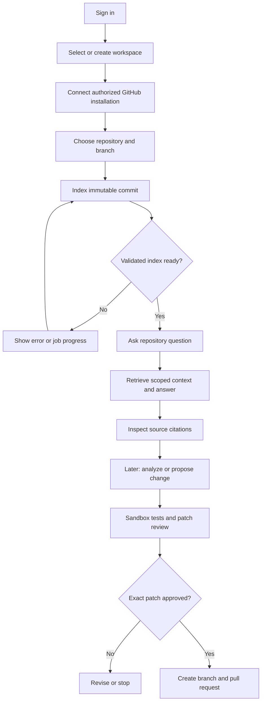
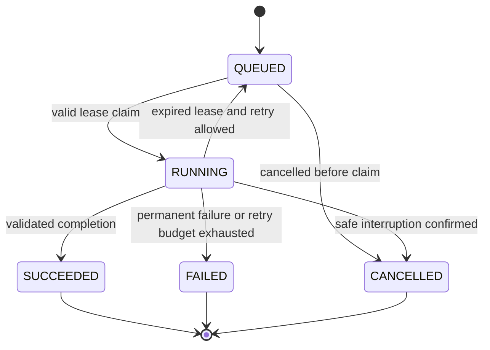

# DevSync AI — Workflow

Date: 25 October 2026. Scope: standalone user and service workflows. MVP is repository connection, immutable indexing and cited repository Q&A; analysis and approved changes are later target capabilities.

## 1. Product journey



## 2. Login and workspace

1. Browser creates state, nonce and PKCE verifier/challenge and redirects to configured OIDC issuer.
2. Browser validates the callback, exchanges the code and keeps the access token in memory.
3. Spring Security validates issuer, audience, signature and expiry; backend loads current memberships.
4. User chooses a workspace or creates one where allowed; the creator receives the initial OWNER membership.
5. Source access still requires a project grant. Administration is not automatic permission to read code.

Initial browser design does not persist refresh/access tokens in localStorage. Reload requires reauthentication; logout clears memory and invokes configured provider logout. Failures preserve no partially trusted identity.

## 3. GitHub connection

Administrator starts a workspace-scoped setup session → follows GitHub authorization/install flow → browser submits code/state/installation ID → backend verifies the administrator's GitHub installation authority → backend issues a one-time setup proof → connect operation consumes the proof and stores integration metadata.

Setup session expires after 10 minutes; proof after 5 minutes. Installation ID knowledge alone is insufficient. Private source stays disabled until approved processors and workspace policy are configured. Repository picker lists only installation-accessible repositories. User selects branch; backend resolves an immutable SHA and grants project access explicitly according to the acting user's permitted role.

## 4. Indexing workflow

```mermaid
sequenceDiagram
  actor U as Developer
  participant API as Spring Boot
  participant DB as PostgreSQL
  participant Q as Kafka
  participant W as Python worker
  participant V as Vector provider
  U->>API: Request indexing + idempotency key
  API->>API: Check grant, repo access, limits; resolve SHA
  API->>DB: Commit job, generation, desired pointer and outbox
  API-->>U: 202 job reference
  API->>Q: Relay durable command
  Q->>W: Deliver command
  W->>API: Claim job lease
  W->>W: Fetch pinned SHA, exclude, parse and chunk
  W->>V: Write inactive generation embeddings
  W->>API: Validate and complete using attempt token
  API->>DB: Atomically activate current intended generation and complete job
  API-->>U: Ready with indexed SHA
```

File policy excludes binary/generated/vendor content, symlink/submodule traversal and secrets. Limits: 100 MiB eligible source, 10,000 files, 1 MiB/file. Tree-sitter creates function/class-aware chunks with source provenance; parse errors use bounded eligible text fallback and explicit quality metadata.

Jobs use a 60-second lease renewed every 20 seconds. At most three processing attempts; permanent permission/configuration errors do not retry automatically. A failed generation remains inactive; existing active index stays usable. Duplicate events are harmless through durable claim/deduplication. A stale attempt cannot activate an index.

## 5. Question-answering workflow

1. Validate conversation ownership, membership, project access and active generation.
2. Capture generation ID and commit SHA; persist question and idempotency intent.
3. Reserve model usage/cost in a durable workspace/day ledger.
4. Call the private AI service through authenticated gRPC with signed scoped context.
5. Embed question with the generation's configured model; retrieve 20 scoped candidates and retain up to 8 bounded chunks.
6. Build prompt from user request, limited history and explicitly untrusted source evidence.
7. Run bounded read-only tools if policy allows; use MCP adapters through the same gateway.
8. Validate model result/citations against canonical source; retry invalid formatting at most once.
9. Persist answer and reference snapshots, reconcile spend, then return success.
10. Frontend displays immutable source references or an explicit insufficient-context result.

Generation never changes mid-answer. A repeated completed request returns its durable result; an in-progress duplicate returns an explicit retryable conflict. Dependency failure is shown as an error, not a fabricated answer.

## 6. Tool calling and MCP

Model requests declared tool → gateway validates schema and execution scope → recheck grants, budgets and approval policy → execute approved native/MCP adapter → validate and bound normalized output → audit sanitized metadata → return evidence to the model.

Maximum six tool invocations per answer; default tool deadline 30 seconds, result cap 64 KiB, answer budget 120 seconds. Model arguments cannot override workspace, project, generation or credentials. MCP discovery never automatically enables new tools. Schema drift disables affected tools until review.

## 7. Analysis and approved change workflow

Maintainer requests analysis at a captured SHA → Kafka schedules the configured SonarQube workflow → results normalize rule/severity/location → backend stores findings → frontend opens exact source references.

For changes: create immutable patch proposal at base SHA → choose approved test profile → run isolated tests → store PASS/FAIL/ERROR/TIMEOUT/CANCELLED → display diff and results → authorized reviewer approves exact repository/base/hash/action for 15 minutes → authorized writer requests PR → backend rechecks all conditions → create deterministic branch and PR → persist external identity and audit result.

Changed patch/base or expired approval blocks writing. Required tests must pass before READY_FOR_REVIEW. A failed test run is visible and does not silently qualify. GitHub response timeout triggers reconciliation before retry. PR creation never automatically merges or deploys.

## 8. States, cancellation and recovery



Cancellation first records intent; UI displays “Cancellation requested” until worker confirms termination. Manual retry creates a new job linked to the terminal original. Proposal flow: DRAFT → TESTING → READY_FOR_REVIEW → APPROVED → PR_CREATING → PR_CREATED, with TEST_FAILED, REJECTED and CANCELLED branches. A changed patch creates a new immutable revision and invalidates approval.

## 9. Reindex, revoke and delete

Reindex builds a new inactive generation and switches only after validation. Membership/integration revocation blocks further sensitive work and invalidates cached authorization. Project deletion atomically tombstones, increments authorization epoch, requests cancellation and creates cleanup receipt; ordinary reads stop immediately. Privileged cleanup removes vectors, artifacts and source data idempotently, targeting 24 hours. Workspace administrator monitors the receipt without restoring source access.

## 10. Workflow acceptance

Every accepted mutation has durable intent and a request/job ID. Every user-visible source result is scoped to an authorized immutable revision. Every asynchronous stage exposes real state and a safe error path. Every external write has exact permission/approval checks and reconciliation. Never show a successful state before its durable outcome exists.
